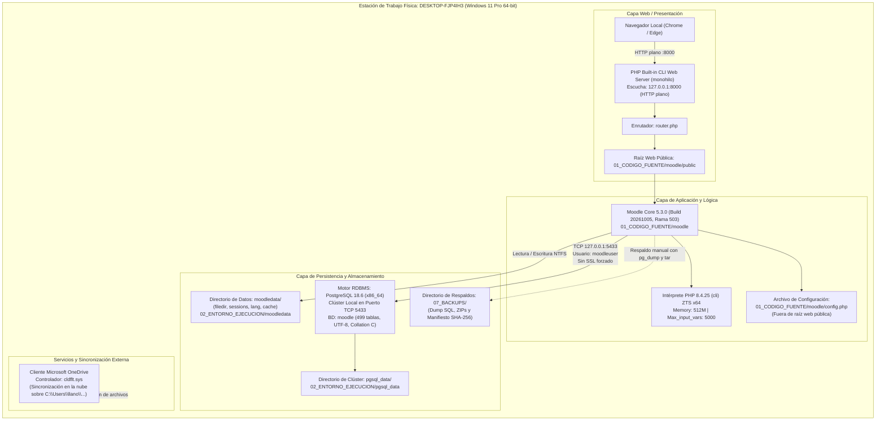

# LEVANTAMIENTO DE INFORMACIÓN TÉCNICA Y DIAGNÓSTICO DE RIESGOS
## PROYECTO MOODLE LMS 5.3 — ACTIVIDAD GRUPAL 1: "DIAGNÓSTICO Y ANÁLISIS DE RIESGOS"

**Asignatura:** Auditoría Informática (INF 881)  
**Documento de Referencia Guía:** `Actividad1.pdf` (Metodología ISO/IEC 27005)  
**Sistema Evaluado:** Moodle LMS Core versión 5.3.0 (`MOODLE-AUDIT`)  
**Fecha de Ejecución del Levantamiento:** 18 de octubre de 2026  
**Periodo Cubierto por las Evidencias Registradas:** 12 de octubre de 2026 al 18 de octubre de 2026  
**Carácter de la Inspección:** Revisión documental y observación de solo lectura no destructiva  
**Archivo de Entrega:** `LEVANTAMIENTO_ACTIVIDAD1_MOODLE.md`  

---

## 1. Reglas de Extracción y Metodología de Observación

El presente levantamiento técnico se ha desarrollado aplicando de manera estricta las siguientes pautas metodológicas y operativas:

1. **Revisión documental y observación de solo lectura:** Toda la información técnica fue recolectada mediante inspección estática del sistema de archivos, lectura de archivos de configuración, consulta de volcados SQL (`pg_dump`), análisis de registros (*logs*), lectura de metadatos de Git y verificación pasiva de procesos y sockets de red. No se modificó ningún archivo del sistema, no se alteraron permisos ni directivas del sistema operativo, no se iniciaron ni detuvieron servicios, y no se ejecutaron ataques, inyecciones de código, escaneos intrusivos ni restauraciones en la base de datos o en el almacenamiento.
2. **Identificación rigurosa de fuentes primarias:** Las fuentes citadas corresponden exclusivamente a documentos de diseño y registro del proyecto, archivos de configuración del aplicativo, volcados relacionales, bitácoras y observaciones directas de la plataforma. No se emplean intermediarios de síntesis ni expresiones atribuidas a asistentes o herramientas de procesamiento.
3. **Revisión crítica de datos anteriores:** Los datos recopilados en ejercicios o informes previos (como `DATOS_PARA_ANALISIS_RIESGOS_ISO27005.md`, `INFORME_INSTALACION_MOODLE.md`, `Fundamentacion_Analisis_Riesgos_Moodle.docx` y `Analisis_Riesgos_Moodle_ISO27005.xlsx`) fueron contrastados contra el estado real de los archivos del repositorio. No se asumieron automáticamente como vigentes sin comprobación empírica.
4. **Tipificación de cada dato:** Conforme a la certeza de su origen, cada dato se clasifica formalmente bajo una de las siguientes cuatro etiquetas:
   - `[OBSERVADO]`: Verificado de manera directa e instrumental en el entorno anfitrión, en los archivos actuales o en la base de datos a la fecha del levantamiento (18/10/2026).
   - `[DOCUMENTADO]`: Registrado en informes técnicos, manifiestos, capturas de pantalla fechadas o bitácoras del expediente técnico generado el 12/10/2026, sin ejecución interactiva en la fecha actual.
   - `[INFERENCIA]`: Deducción lógica, técnica o arquitectónica fundada a partir de configuraciones o directivas observadas, identificada explícitamente como tal.
   - `[PENDIENTE DE CONFIRMACIÓN]`: Condición o dato requerido por la guía académica cuya fuente no está disponible en el entorno local, presenta contradicciones o requiere ratificación formal por el responsable institucional o el docente.
5. **Registro de evidencias con doble fechado:** Toda evidencia técnica cuenta con un identificador unívoco, archivo o comando de origen, sección inspeccionada, resultado obtenido y distinción explícita entre la fecha del evento documentado (principalmente 12/10/2026) y la fecha de revisión técnica (18/10/2026).
6. **Transparencia en acceso a fuentes:** Cuando una fuente no estuvo disponible o arrojó restricción de privilegios (por ejemplo, consulta de directivas avanzadas de firewall de Windows en espacio de usuario no elevado), se declara abiertamente dicha limitación.
7. **Redacción y protección de información sensible:** No se reproducen contraseñas en texto claro, secretos de conexión a base de datos, *hashes* de contraseñas de usuarios ni tokens de sesión. Los valores confidenciales se reemplazan sistemáticamente por etiquetas como `[REDACTADO: CREDENCIAL DE ACCESO]` o `[GESTIONADA DE FORMA SEPARADA]`.
8. **Precisión epistemológica sobre controles:** La ausencia de evidencia de un control documentado no se confunde con la inexistencia del control; se registra como "Control sin evidencia documental u observable".
9. **Exclusión de datos del ejemplo académico:** Se descartan de forma categórica todos los datos del sistema de ejemplo "SICAF" (empresa farmacéutica/comercializadora) presentado en la guía `Actividad1.pdf`.
10. **Segregación entre entorno simulado y realidad institucional:** Se establece una distinción nítida entre los datos de prueba del laboratorio (usuarios simulados, curso ficticio `AUD-101`, notas de prueba) y la realidad operativa del equipo de trabajo y de la institución educativa.
11. **Prohibición de invención de datos:** Ningún campo o fila vacía de las planillas ha sido rellenado con datos ficticios no sustentados.

---

## 2. Identificación y Contexto

### 2.1 Metadatos Generales del Proyecto

- **Nombre del proyecto y del sistema:** `Moodle Auditoria ISO` (Nombre corto del sistema: `MOODLE-AUDIT`). `[DOCUMENTADO / OBSERVADO: config.php, mdl_course]`
- **Institución y sección o unidad responsable:**
  - *Contexto simulado en plataforma:* «Facultad de Auditoría y Seguridad de la Información» (categoría raíz `FAC-AUD`), curso `AUD-101 Auditoría de Sistemas de Información`. `[OBSERVADO: moodle_database_20261012_171651.sql, tabla mdl_course_categories]`
  - *Institución real responsable:* Universidad / Carrera de Informática (Octavo Semestre). Denominación institucional formal exacta: `[PENDIENTE DE CONFIRMACIÓN]`.
  - *Unidad responsable del laboratorio:* Asignatura de Auditoría Informática (INF 881). `[DOCUMENTADO: Actividad1.pdf]`
- **Responsable de la auditoría y participantes:**
  - *Docente de la asignatura:* Lic. Erick Sierra Caballero. `[DOCUMENTADO: Actividad1.pdf, carátula]`
  - *Auditor / Integrante del equipo de trabajo:* Alfredo Llanos Taca. `[DOCUMENTADO: Analisis_Riesgos_Moodle_ISO27005.xlsx, hoja "planilla D", celda A4]`
  - *Participantes adicionales del grupo de trabajo:* `[PENDIENTE DE CONFIRMACIÓN]` (requiere incorporar la nómina completa de los integrantes del grupo estudiantil).
  - *Responsable técnico formal del sistema evaluado (administrador del host):* Operador local de la estación de trabajo `DESKTOP-FJP4IH3\llano`. `[OBSERVADO: Get-Acl config.php, Get-ComputerInfo]`
- **Fecha del levantamiento y periodo cubierto:**
  - *Fecha de ejecución del presente levantamiento:* 18 de octubre de 2026. `[OBSERVADO]`
  - *Periodo cubierto por los eventos técnicos analizados:* 12 de octubre de 2026 (instalación, configuración, generación de respaldos y pruebas) al 18 de octubre de 2026 (inspección de archivos y comprobaciones de estado). `[DOCUMENTADO / OBSERVADO]`
- **Finalidad del proyecto y condición del entorno:**
  - *Finalidad:* Laboratorio técnico experimental y banco de pruebas de auditoría de sistemas para la aplicación de la metodología de análisis y gestión de riesgos ISO/IEC 27005:2022 y evaluación de controles de seguridad de la información. `[DOCUMENTADO: README_PROYECTO.md, sección 1]`
  - *Condición del entorno:* **Laboratorio académico local aislado** (no es un entorno de producción, ni un servidor de pruebas abierto a Internet). Opera con datos 100% ficticios y cuentas simuladas. `[OBSERVADO: config.php, router.php, mdl_user]`

---

### 2.2 Tabla de Contexto Organizacional (Planilla 1 de la Guía Académica)

La guía académica `Actividad1.pdf` (Planilla 1: Contexto de la Organización) exige el llenado de cinco elementos estructurados. A continuación se presentan con la información real encontrada, su evidencia y estado de confirmación:

| Elemento | Información encontrada en el proyecto | Evidencia técnica y documental | Estado de confirmación |
| :--- | :--- | :--- | :---: |
| **1. Misión** | *Nivel Institucional Real:* No existe una declaración de misión institucional formalmente documentada en el repositorio del proyecto Moodle. No se deduce de la misión de Moodle HQ ni de textos genéricos. *Nivel Operativo del Laboratorio:* Proveer una plataforma LMS local plenamente funcional, auditable e inmutable para ejecutar prácticas formativas de auditoría de sistemas y análisis de riesgos bajo normas ISO/IEC. | Revisión de `README_PROYECTO.md` y ausencia de declaraciones institucionales en la base de datos `moodle`. | **PENDIENTE DE CONFIRMACIÓN** *(La misión institucional universitaria debe ser provista por el responsable del proyecto / grupo de trabajo)* |
| **2. Objetivos de negocio o institucionales** | *Objetivos Académicos Verificados:* 1. Desplegar y mantener operativo un entorno Moodle LMS 5.3 sobre PostgreSQL 18 para experimentación técnica de auditoría. 2. Evaluar la postura de seguridad y el inventario de activos conforme a ISO/IEC 27005. 3. Generar y custodiar evidencia forense, trazas de auditoría y copias de seguridad de las prácticas. *Metas Cuantitativas Institucionales:* No documentadas (no existen metas de porcentaje de reducción de incidentes o disponibilidad SLA formal). | `00_CONTROL_PROYECTO/INFORME_INSTALACION_MOODLE.md`, sección 1; `08_PRUEBAS/MATRIZ_PRUEBAS_VERIFICACION.md`. | **DOCUMENTADO (a nivel de laboratorio) / PENDIENTE DE CONFIRMACIÓN (metas institucionales formales)** |
| **3. Partes interesadas y su relación con el sistema** | *Identificadas en el entorno del proyecto:* 1. **Docente Evaluador (Lic. Erick Sierra Caballero):** Define requisitos académicos, revisa informes, evalúa matrices de riesgos y guía la práctica. 2. **Equipo de Estudiantes / Auditores (Alfredo Llanos Taca y miembros del grupo):** Ejecutan el levantamiento técnico, analizan configuraciones, custodian evidencias y elaboran planillas. 3. **Operador Técnico / Custodio Local:** Administra el equipo host `DESKTOP-FJP4IH3`, ejecuta scripts de inicio y respaldos. 4. **Usuarios Simulados de la Plataforma:** Roles docentes (`profesor1`, `profesor2`) y estudiantes (`estudiante1` a `estudiante5`) que representan actores en las pruebas funcionales. | `Actividad1.pdf`, carátula; `Analisis_Riesgos_Moodle_ISO27005.xlsx`; `mdl_user` en volcado SQL `moodle_database_20261012_171651.sql`. | **OBSERVADO / DOCUMENTADO** |
| **4. Entorno legal y políticas aplicables documentadas** | *Marco Normativo Estudiado en el Proyecto:* - Familia ISO/IEC: ISO/IEC 27001:2022, ISO/IEC 27002:2022, ISO/IEC 27005:2022, ISO 19011:2026, ISO/IEC 25010:2023, ISO/IEC 25040:2024. - Licenciamiento de Software: Licencia GNU General Public License v3.0 (`GPL-3.0-or-later`) de Moodle Core. *Leyes Nacionales y Políticas Institucionales:* En el repositorio no existen políticas internas de seguridad aprobadas, reglamentos de régimen docente ni leyes de protección de datos personales formalmente vinculadas al laboratorio. No se asume la aplicabilidad de normas externas (como GDPR o SOX) sin mandato explícito. | Fichas normativas en `09_AUDITORIA_ISO/`; archivo `04_DOCUMENTACION_OFICIAL/20_Licencia/PDF_GENERADO_DESDE_MOODLEDATA_Licencia_GPLv3_Moodle.pdf`. | **DOCUMENTADO (estándares ISO y GPL) / PENDIENTE DE CONFIRMACIÓN (marco legal nacional e institucional)** |
| **5. Límites del SGSI para este análisis** | *Alcance Incluido:* - **Procesos:** Los 6 procesos identificados del laboratorio (P01 Gestión de identidades, P02 Gestión de cursos y evaluación, P03 Logging de auditoría, P04 Mantenimiento del cron, P05 Respaldo y recuperación, P06 Hardening y seguridad). - **Componentes de Software:** Moodle Core 5.3.0, base de datos PostgreSQL 18.6, intérprete PHP 8.4.25 y servidor web de desarrollo embebido. - **Almacenamiento y Datos:** Código fuente en `01_CODIGO_FUENTE\moodle`, directorio `moodledata`, clúster `pgsql_data`, archivos de respaldo en `07_BACKUPS/` y 9 cuentas de usuario. - **Ubicación:** Estación de trabajo física monousuario `DESKTOP-FJP4IH3` en entorno local aislado. *Exclusiones Formales:* - Servidores de producción, infraestructura en la nube multi-inquilino, servicios de correo saliente SMTP, pasarelas de pago y redes LAN/WAN externas. *Interfaces Externas:* Sincronización de la carpeta del proyecto hacia Microsoft OneDrive (`cldflt.sys`). | `00_CONTROL_PROYECTO/INFORME_INSTALACION_MOODLE.md`, secciones 2, 3 y 24; `config.php`; `router.php`. | **OBSERVADO** |

> [!NOTE]
> Conforme a la regla de no inventar información institucional desconocida y de no generar firmas ficticias, los datos institucionales no documentados se formulan en la sección de preguntas pendientes para el responsable del proyecto.

---

## 3. Descripción Técnica y Operativa del Sistema Moodle

### 3.1 Actividades de la Plataforma: Capacidades Teóricas vs. Uso Real Observado

Moodle LMS provee nativamente una amplia gama de módulos (comercio electrónico, pasarelas de pago, autenticación OAuth2/SAML, videoconferencia BigBlueButton, mensajería SMS, insignias/badges, analítica de aprendizaje predictiva). Sin embargo, en este proyecto de auditoría **únicamente se utilizan y han sido verificadas las siguientes actividades**:

1. **Autenticación local basada en contraseñas:** Ingreso mediante formulario `/login/index.php` con credenciales gestionadas en la base de datos interna (`auth_manual`). `[OBSERVADO: mdl_user, auth = 'manual']`
2. **Navegación administrativa:** Configuración del sitio y reporte de parámetros en `/admin/`. `[OBSERVADO: EVID-004]`
3. **Gestión y visualización de un curso académico:** Curso de prueba `AUD-101` estructurado en 4 secciones temáticas. `[OBSERVADO: mdl_course, mdl_course_sections]`
4. **Módulo de Tareas (`mod_assign`):** Configuración de la tarea "Tarea 1: Matriz de Control de Riesgos", recepción de un archivo de entrega simulado y asignación de calificación manual (95/100). `[OBSERVADO: mdl_assign, mdl_assign_submission, mdl_assign_grades]`
5. **Módulo de Cuestionarios (`mod_quiz`):** Cuestionario "Cuestionario Diagnóstico: Principios de Auditoría", banco de preguntas (`mod_qbank`) e intentos de examen de prueba. `[OBSERVADO: mdl_quiz, mdl_quiz_attempts]`
6. **Módulo de Foros (`mod_forum`):** Foro técnico de debate para intercambio académico en el curso `AUD-101`. `[OBSERVADO: mdl_forum, mdl_forum_discussions]`
7. **Libro de Calificaciones (`gradebook`):** Registro de notas numéricas en `mdl_grade_grades`. `[OBSERVADO]`
8. **Logging de auditoría:** Captura automática de eventos en `mdl_logstore_standard_log`. `[OBSERVADO]`
9. **Tareas de mantenimiento (Cron):** Disparo manual mediante script CLI para procesamiento de colas y sesiones. `[OBSERVADO: cron.log]`
10. **Comprobaciones de seguridad:** Reporte de directivas y línea base en `/report/security/`. `[OBSERVADO: checks_seguridad.json]`

*Actividades NO utilizadas ni habilitadas:* Registro abierto de usuarios (`register_auth` deshabilitado), acceso anónimo de invitados a cursos, integración con servicios LDAP/Active Directory, pasarelas de pago y complementos de terceros (0 plugins no nativos instalados). `[OBSERVADO: mdl_config_plugins, 01_CODIGO_FUENTE/moodle/public/mod/]`

---

### 3.2 Arquitectura del Sistema y Dependencias Verificadas

La arquitectura desplegada corresponde a una **topología monolítica local** confinada integralmente en una única estación de trabajo:

- **Separación de raíz pública (`public/`):** Característica arquitectónica introducida en Moodle 5.x. La raíz servida por el servidor web es `01_CODIGO_FUENTE/moodle/public`. El núcleo del código, las librerías (`/lib`), los scripts de administración CLI (`/admin/cli`) y el archivo `config.php` se encuentran en el directorio superior (`..`), impidiendo su acceso directo vía URL desde el navegador. `[OBSERVADO: config.php, router.php]`
- **Aislamiento de `moodledata` (`$CFG->dataroot`):** Ubicado en `02_ENTORNO_EJECUCION/moodledata`, completamente fuera del árbol web público, lo que previene descargas directas no autenticadas de tareas o archivos de sesión. `[OBSERVADO: config.php, línea 21]`

---

### 3.3 Versiones Verificadas y Fuentes de Comprobación

| Componente | Versión Exacta | Fuente de Comprobación | Fecha de Verificación | Estado |
| :--- | :--- | :--- | :---: | :---: |
| **Moodle Core** | **5.3.0** (Build: `20261005`, `$version = 2026100500.00`, Rama: `503`, Madurez: `MATURITY_STABLE`) | `version.php`, Git Tag `v5.3.0`, Commit `42622298...`, tabla `mdl_config` | 18/10/2026 | **OBSERVADO / DOCUMENTADO** |
| **Sistema Operativo** | **Microsoft Windows 11 Pro 64-bit** (Versión 10.0.26300, Compilación 26300) | `cmd.exe /c ver`, `Get-ComputerInfo` | 18/10/2026 | **OBSERVADO** |
| **Servidor Web** | **PHP Built-in Development Server** (ejecutado con `router.php`) | Script `iniciar_moodle.ps1`, `router.php`, socket `127.0.0.1:8000` | 18/10/2026 | **DOCUMENTADO / OBSERVADO** |
| **Intérprete PHP** | **PHP 8.4.25 (cli)** (ZTS Visual C++ 2022 x64, 64-bit real con `PHP_INT_SIZE = 8`) | `php -v`, `php.ini`, `EVID-006_Informacion_PHP.png` | 18/10/2026 | **OBSERVADO** |
| **Base de Datos** | **PostgreSQL 18.6** (x86_64-windows, MSVC 19.44.35228, 64-bit) | `SELECT version();`, `postgresql_cluster.log`, `check_moodle_environment()` | 18/10/2026 | **DOCUMENTADO / OBSERVADO** |
| **Almacenamiento** | **NTFS en unidad local `C:\`** (354 GB disponibles al momento de la instalación) | `Get-Volume`, `INFORME_INSTALACION_MOODLE.md` | 18/10/2026 | **OBSERVADO** |

---

### 3.4 Acceso de Red, Interfaces y Puertos Relevantes

- **Interfaz de escucha de la aplicación:** Dirección de bucle local (*loopback*) `127.0.0.1:8000` (o `localhost:8000`). `[DOCUMENTADO: config.php, iniciar_moodle.ps1]`
- **Interfaz de escucha de la base de datos:** `127.0.0.1:5433` (puerto dedicado asignado para no colisionar con el puerto 5432 preexistente en la máquina). `[OBSERVADO: config.php, postgresql.conf, postmaster.pid]`
- **Exposición a redes LAN o Internet:** **Nula (No expuesto).** Ni el servidor web PHP ni el clúster de PostgreSQL escuchan en interfaces públicas `0.0.0.0` en sus scripts de despliegue. No existen reglas de reenvío de puertos (*port forwarding* en routers), ni registros DNS públicos, ni túneles activos de publicación externa (ngrok, Cloudflare Tunnel). `[OBSERVADO: netsh interface portproxy show all, config.php]`
- **Protocolo de transporte web:** **HTTP plano (no cifrado).** No existe certificado TLS/SSL configurado en el servidor web de desarrollo local. Las cookies de sesión se transmiten en texto claro sin la bandera `Secure`. `[OBSERVADO: config.php, checks_seguridad.json: core_cookiesecure WARNING]`

---

### 3.5 Ubicaciones Físicas y Lógicas de Componentes

| Componente | Ubicación en Disco (Ruta Relativa / Absoluta) | Descripción y Tipo de Almacenamiento |
| :--- | :--- | :--- |
| **Código Fuente** | `01_CODIGO_FUENTE\moodle\` | Árbol Git inmutable descargado desde repositorio oficial de Moodle HQ. |
| **Raíz Pública Web** | `01_CODIGO_FUENTE\moodle\public\` | Raíz servida al navegador (`index.php`, recursos estáticos). |
| **Configuración** | `01_CODIGO_FUENTE\moodle\config.php` | Archivo PHP de configuración del sitio (credenciales de BD, rutas y permisos). |
| **Directorio de Datos (`moodledata`)** | `02_ENTORNO_EJECUCION\moodledata\` | Archivos de tareas (`filedir`), sesiones (`sessions`), paquetes de idioma (`lang`) y caché (`muc`). |
| **Clúster PostgreSQL** | `02_ENTORNO_EJECUCION\pgsql_data\` | Directorio de datos del clúster RDBMS dedicado (tablas relacionales, índices, configuración). |
| **Registros de Auditoría** | 1. Tabla `mdl_logstore_standard_log` (en BD `moodle`). 2. `06_EVIDENCIAS_INSTALACION\logs\cron.log`. 3. `06_EVIDENCIAS_INSTALACION\logs\install_database.log`. | Registros estructurados en base de datos relacional y archivos de texto plano para soporte. |
| **Respaldos (Backups)** | `07_BACKUPS\` (subcarpetas `moodle_database`, `moodledata`, `moodle_codigo`) | Archivos comprimidos ZIP, volcado SQL y archivo `MANIFIESTO_BACKUP.txt`. |

---

### 3.6 Relación con OneDrive y Servicios Externos

El proyecto se encuentra alojado dentro del árbol de directorios de usuario sincronizado por el cliente de escritorio de **Microsoft OneDrive** (`C:\Users\llano\OneDrive\...`).  
- **Evidencia del incidente de bloqueo:** En `00_CONTROL_PROYECTO/INFORME_VERIFICACION_PREAUDITORIA.md` (sección 9, líneas 100-101) y bitácoras de Git se documenta que el controlador de filtro en la nube de OneDrive (`cldflt.sys` / error `0x9000a01a`) interfirió en el sistema de archivos marcando bloqueos temporales sobre archivos de script (`admin/cli/cron.php`). `[DOCUMENTADO]`
- **Consecuencias operativas:** Puede ocasionar excepciones de acceso denegado o colisiones de versiones locales/remotas durante la edición o ejecución de scripts administrativos. `[INFERENCIA]`
- **Recuperación externa:** **No existe evidencia de recuperación externa verificada.** No se ha ejecutado una restauración de datos desde el almacenamiento en la nube de OneDrive ni se ha auditado la retención de versiones del proveedor. `[PENDIENTE DE CONFIRMACIÓN]`

---

### 3.7 Tipos de Información Almacenada y Naturaleza de los Datos

- **Tipos de datos gestionados:** Metadatos de configuración de Moodle, definiciones de roles y permisos RBAC, cuentas de usuario, credenciales hasheadas (`bcrypt`), catálogo de cursos, enunciados de tareas y preguntas de examen, entregas simuladas en formato PDF/DOCX, calificaciones numéricas y trazas cronológicas de eventos de auditoría (*logs*).
- **Naturaleza de los datos:** **100% DATOS FICTICIOS Y SIMULADOS.** Las personas nombradas en las cuentas de usuario (`Carlos M. Mendoza`, `Mateo Morales`, etc.) no corresponden a funcionarios, docentes ni alumnos reales de ninguna institución. Los archivos adjuntos en tareas son documentos de prueba de laboratorio. No existen datos personales sensibles reales en la base de datos que infrinjan normativas de privacidad de terceros. `[OBSERVADO: crear_datos_auditoria.php, volcado SQL]`

---

### 3.8 Conteo Exhaustivo y Conciliación de Cuentas de Usuario

La revisión directa del volcado oficial de la base de datos relacional (`COPY public.mdl_user` en `moodle_database_20261012_171651.sql`) y de la tabla de usuarios permite conciliar de forma exacta la población de identidades, evitando duplicidades y aclarando discrepancias presentes en documentos previos:

| ID en BD | Nombre de Usuario (`username`) | Nombre Completo | Rol Funcional Asignado | Contexto de Asignación | Estado de la Cuenta | Tipo de Cuenta |
| :---: | :--- | :--- | :--- | :--- | :---: | :--- |
| **1** | `guest` | Guest user | Invitado (`guest`) | Sistema global | Activa (`suspended=0, deleted=0`) | Cuenta especial del sistema (`$CFG->siteguest`) |
| **2** | `admin_auditoria` | Admin User | Administrador de Auditoría (`admin`) | Contexto de Sistema | Activa (`suspended=0, deleted=0`) | Cuenta operativa administrativa |
| **3** | `profesor1` | Carlos M. Mendoza | Docente con edición (`editingteacher`) | Curso AUD-101 (Context ID 3) | Activa (`suspended=0, deleted=0`) | Cuenta operativa de prueba |
| **4** | `profesor2` | Elena R. Valenzuela | Docente con edición (`editingteacher`) | Curso AUD-101 (Context ID 3) | Activa (`suspended=0, deleted=0`) | Cuenta operativa de prueba |
| **5** | `estudiante1` | Mateo Morales | Estudiante (`student`) | Curso AUD-101 (Context ID 3) | Activa (`suspended=0, deleted=0`) | Cuenta operativa de prueba |
| **6** | `estudiante2` | Sofía Benítez | Estudiante (`student`) | Curso AUD-101 (Context ID 3) | Activa (`suspended=0, deleted=0`) | Cuenta operativa de prueba |
| **7** | `estudiante3` | Lucas Fernández | Estudiante (`student`) | Curso AUD-101 (Context ID 3) | Activa (`suspended=0, deleted=0`) | Cuenta operativa de prueba |
| **8** | `estudiante4` | Valentina Cruz | Estudiante (`student`) | Curso AUD-101 (Context ID 3) | Activa (`suspended=0, deleted=0`) | Cuenta operativa de prueba |
| **9** | `estudiante5` | Joaquín Silva | Estudiante (`student`) | Curso AUD-101 (Context ID 3) | Activa (`suspended=0, deleted=0`) | Cuenta operativa de prueba |

#### Resumen y Conciliación del Censo de Cuentas:
- **Total de cuentas únicas registradas en `mdl_user`:** **9 cuentas**. `[OBSERVADO: COPY public.mdl_user]`
- **Cuentas operativas asignadas a roles funcionales de laboratorio:** **8 cuentas** (1 administrador, 2 docentes, 5 estudiantes).
- **Cuentas especiales del sistema:** **1 cuenta** (`guest`, ID 1).
- **Cuentas activas:** **9 cuentas** (`confirmed = 1`, `suspended = 0`).
- **Cuentas suspendidas:** **0 cuentas** (`suspended = 0`).
- **Cuentas eliminadas:** **0 cuentas** (`deleted = 0`).
- **Personas reales asociadas:** **1 persona física real** (el estudiante/auditor operador de la máquina). Las 8 cuentas operativas representan funciones y perfiles simulados, no personas naturales independientes.
- **Aclaración de discrepancias documentales previas:** Documentos preliminares mencionaban "9/10 cuentas" por presunción teórica de una cuenta adicional de sistema (`nobody` o cuenta 0). La inspección técnica empírica de la base de datos demuestra categóricamente que solo existen las 9 filas listadas arriba.

---

## 4. Identificación de Procesos

La guía académica `Actividad1.pdf` (Planilla 2: Identificación de Procesos) presenta un formato en blanco con 7 filas numeradas. Sin embargo, en el entorno Moodle del laboratorio se han identificado **seis (6) procesos reales, funcionales y de soporte efectivamente existentes**.  
Conforme a la regla de no inventar procesos para rellenar espacios vacíos, se conservan los identificadores originales (`P01` a `P06`) y se fundamenta la exclusión de una séptima fila artificial:

| ID | Proceso | Finalidad | Descripción de lo realizado en el proyecto | Participantes | Activos relacionados | Evidencia técnica |
| :---: | :--- | :--- | :--- | :--- | :--- | :--- |
| **P01** | **Gestión de Identidades, Autenticación y Control de Acceso (IAM)** | Garantizar que solo los usuarios autorizados accedan a recursos específicos conforme a sus roles y privilegios (RBAC). | Creación de 8 cuentas de laboratorio (`admin`, docentes, estudiantes), autenticación vía formulario web, hash seguro de contraseñas (`bcrypt`), asignación granular de capacidades en contextos y rotación de contraseñas expuestas. | Administrador de Auditoría (`admin_auditoria`), Usuarios de prueba | A01, A03, A04, A11, A12, A13, A14 | Tablas `mdl_user`, `mdl_role_assignments`; script `cambiar_credenciales_laboratorio.php`; capturas `EVID-002`, `EVID-008`, `EVID-009`. |
| **P02** | **Gestión de Cursos y Evaluación Académica** | Sustentar el ciclo de enseñanza-aprendizaje y evaluación, garantizando la integridad de contenidos, entregas y notas. | Estructuración del curso `AUD-101` en 4 tópicos, matriculación de 7 usuarios (`enrol_manual`), publicación de tarea y cuestionario, recepción de entregas simuladas y registro de calificaciones en el libro de notas. | Docentes (`profesor1`, `profesor2`), Estudiantes (`estudiante1` a `estudiante5`) | A01, A02, A03, A10, A13, A14 | Tablas `mdl_course`, `mdl_assign_submission`, `mdl_grade_grades`; capturas `EVID-010`. |
| **P03** | **Registro, Monitoreo y Trazabilidad de Auditoría (Logging Forense)** | Capturar, persistir y consultar trazas cronológicas de eventos del sistema para no repudio y reconstrucción de incidentes. | Captura automática de 42 eventos en el almacén de eventos nativo (`logstore_standard`), consulta y filtrado de bitácoras desde el panel administrativo `/report/log/`. | Administrador de Auditoría (`admin_auditoria`), Moodle Core | A01, A03, A10, A12 | Tabla `mdl_logstore_standard_log`; captura `EVID-011`. |
| **P04** | **Mantenimiento Operativo y Tareas Programadas (Cron y Caché)** | Mantener la estabilidad del aplicativo mediante ejecución de tareas periódicas de fondo (limpieza de sesiones, colas adhoc). | Ejecución del script CLI `admin/cli/cron.php` mediante envoltorio de PowerShell; registro de ejecución en bitácora; identificación de advertencia de retraso por falta de disparo automático continuo. | Administrador del Sistema / Operador local | A01, A03, A06, A07, A10, A12 | Script `ejecutar_cron.ps1`; archivo `cron.log`; captura `EVID-014`; comprobación en `checks.php`. |
| **P05** | **Gestión de Respaldo y Continuidad Operativa (Backup)** | Proteger la información contra pérdida física o corrupción, sustentando la recuperación del laboratorio. | Ejecución manual del script `ejecutar_backup_completo.ps1`, generación de volcado SQL de PostgreSQL, empaquetado tar/zip de `moodledata` y código fuente, y cálculo de firmas criptográficas SHA-256. | Administrador del Sistema / Operador local | A01, A02, A03, A04, A08, A09, A12 | Script `ejecutar_backup_completo.ps1`; carpeta `07_BACKUPS/`; manifiesto `MANIFIESTO_BACKUP.txt`; captura `EVID-013`. |
| **P06** | **Gestión de Configuración y Seguridad de la Infraestructura (Hardening)** | Configurar y supervisar los parámetros del entorno técnico (PHP, PostgreSQL, servidor web, directivas Moodle) contra una línea base. | Aislamiento de la raíz web en `/public`, ubicación externa de `moodledata`, configuración de clúster PostgreSQL en puerto 5433, ejecución de 20 comprobaciones de seguridad nativas (`report_security`) y conservación de hallazgos para auditoría. | Administrador del Sistema / DevOps | A01, A03, A04, A05, A06, A07, A08, A12 | Archivos `config.php`, `php.ini`, `pg_hba.conf`; reporte `REPORTE_LINEA_BASE_SEGURIDAD.md`; archivo `checks_seguridad.json`; captura `EVID-012`. |

> [!IMPORTANT]
> **Fundamentación sobre la séptima fila del formato:**  
> La plantilla de la guía académica contiene 7 filas en blanco. En el laboratorio evaluado solo existen 6 procesos reales operativos. Procesos potenciales adicionales (como "Gestión de Cambios y Actualizaciones de Software" o "Gestión de Incidentes de Seguridad") constituyen **propuestas de mejora futura** que actualmente carecen de procedimientos formalizados, herramientas o registros de ejecución. Crear un proceso ficticio para rellenar la fila 7 violaría la regla 11 de extracción. Por tanto, la fila 7 se declara formalmente como **BRECHA DE PROCESO / NO IMPLEMENTADO**.

---

## 5. Inventario y Clasificación de Activos

### 5.1 Tabla Principal de Inventario (Columnas Exigidas por la Guía Académica)

Se identifican **14 activos pertinentes** presentes en el laboratorio. Cada activo se clasifica según la taxonomía de tipos de activo de la guía y de ISO/IEC 27005 (Información, Software, Hardware, Configuración, Personas/Roles).

Para las dimensiones de **Confidencialidad (C), Integridad (I) y Disponibilidad (D)** se aplican los criterios cualitativos textuales de la guía académica:
- **Alta:** Impacto crítico en caso de compromiso para la continuidad del laboratorio o validez de la auditoría.
- **Media:** Impacto significativo pero manejable en el marco de la práctica.
- **Baja:** Impacto limitado o fácilmente subsanable.

| ID | Activo | Descripción / Dependencia | Tipo | Cantidad | Propietario / Custodio | C | I | D | Ubicación |
| :---: | :--- | :--- | :--- | :---: | :--- | :---: | :---: | :---: | :--- |
| **A01** | **Base de Datos Relacional `moodle`** | Base de datos lógica con 499 tablas relacionales. Almacena usuarios, contraseñas hasheadas, calificaciones, inscripciones y bitácoras. *Depende de:* A05, A08. | Información estructurada | 1 base de datos (499 tablas) | *Propietario:* Responsable de Auditoría *Custodio:* Operador del RDBMS | **Media** | **Alta** | **Alta** | *Lógica:* PostgreSQL clúster 5433 *Física:* `02_ENTORNO_EJECUCION\pgsql_data` en estación `DESKTOP-FJP4IH3` |
| **A02** | **Directorio de Datos (`moodledata`)** | Directorio de almacenamiento en disco para archivos entregados por estudiantes (`filedir`), archivos de sesión activa, paquetes de idioma y caché local. *Depende de:* A07, A08. | Información no estructurada / Archivos | 1 estructura de directorios (4.74 MB comprimido) | *Propietario:* Responsable de Auditoría *Custodio:* Operador del sistema operativo | **Media** | **Alta** | **Media** | *Lógica:* `$CFG->dataroot` *Física:* `02_ENTORNO_EJECUCION\moodledata` en disco C:\ |
| **A03** | **Código Fuente Moodle Core 5.3** | Árbol completo de código PHP de la versión oficial Moodle 5.3.0 (Build 20261005, Tag `v5.3.0`, Commit `42622298...`). Inmutable. *Depende de:* A06, A07. | Software de aplicación | 1 árbol de código Git (~151.65 MB comprimido) | *Propietario:* Moodle HQ (Licencia GPLv3) *Custodio:* Operador local | **Baja** | **Alta** | **Alta** | *Lógica:* Repositorio Git local *Física:* `01_CODIGO_FUENTE\moodle` en disco C:\ |
| **A04** | **Archivo de Configuración (`config.php`)** | Archivo maestro de parámetros del aplicativo: conexión al RDBMS, credenciales de BD (`moodleuser`), URLs base y rutas absolutas. *Depende de:* A07, A08. | Configuración y credenciales | 1 archivo de texto PHP (842 bytes) | *Propietario:* Responsable de Auditoría *Custodio:* Operador del sistema | **Alta** | **Alta** | **Alta** | *Lógica:* Raíz de Moodle (fuera de `public/`) *Física:* `01_CODIGO_FUENTE\moodle\config.php` |
| **A05** | **Motor de Base de Datos PostgreSQL 18.6** | Instancia local del motor relacional PostgreSQL (64-bit) ejecutándose en puerto TCP 5433 dedicado. *Depende de:* A07, A08. | Software de infraestructura | 1 instancia de software / proceso | *Propietario:* Administrador del Laboratorio *Custodio:* Operador local | **Baja** | **Alta** | **Alta** | *Lógica:* Proceso `postgres.exe` (Puerto 5433) *Física:* `C:\Program Files\PostgreSQL\18\bin` |
| **A06** | **Intérprete PHP 8.4 y Servidor Web Embebido** | Entorno de ejecución PHP 8.4.25 (cli) y proceso servidor web de desarrollo ejecutado con `router.php` en puerto 8000. *Depende de:* A07, A08. | Software de plataforma | 1 entorno de ejecución y 1 proceso servidor | *Propietario:* Administrador del Laboratorio *Custodio:* Operador local | **Baja** | **Media** | **Alta** | *Lógica:* Proceso `php.exe` (Puerto 8000) *Física:* `%LOCALAPPDATA%\Microsoft\WinGet\...` |
| **A07** | **Sistema Operativo Windows 11 Pro** | Sistema operativo anfitrión (Build 26300, 64-bit). Gestiona permisos NTFS, memoria, procesos locales y pila de red TCP/IP. *Depende de:* A08. | Software de sistema | 1 instalación de SO (Build 26300) | *Propietario:* Propietario del equipo físico *Custodio:* Operador local (`llano`) | **Media** | **Alta** | **Alta** | *Lógica:* Host OS `DESKTOP-FJP4IH3` *Física:* Partición del sistema en disco C:\ |
| **A08** | **Estación de Trabajo y Disco Local C:\** | Equipo de cómputo físico (CPU x86_64, 16 GB RAM, disco NTFS con 354 GB disponibles). Aloja todo el laboratorio. *Depende de:* Suministro eléctrico. | Hardware | 1 equipo de cómputo físico | *Propietario:* Operador del equipo *Custodio:* Operador local (`llano`) | **Media** | **Alta** | **Alta** | *Lógica:* Volumen NTFS C:\ *Física:* Ubicación física del equipo de cómputo de trabajo |
| **A09** | **Conjunto de Respaldos (Backups)** | Conjunto de 3 archivos de respaldo (volcado SQL 2.05 MB, `moodledata` ZIP 4.74 MB, código ZIP 151.65 MB) y manifiesto SHA-256. *Depende de:* A07, A08. | Información de respaldo | 1 conjunto (3 archivos + 1 manifiesto) | *Propietario:* Responsable de Auditoría *Custodio:* Operador local | **Media** | **Alta** | **Alta** | *Lógica:* Carpeta `07_BACKUPS/` *Física:* Disco C:\ y ruta sincronizada de OneDrive |
| **A10** | **Registros de Auditoría y Bitácoras** | Trazas estructuradas de eventos en `mdl_logstore_standard_log` (42 eventos documentados) y bitácoras de texto (`cron.log`). *Depende de:* A01, A07, A08. | Información de trazabilidad | 2 soportes de registro (1 tabla BD + 1 archivo log) | *Propietario:* Responsable de Auditoría *Custodio:* Operador local | **Baja** | **Alta** | **Media** | *Lógica:* BD `moodle` y archivo `logs\cron.log` *Física:* Disco C:\ |
| **A11** | **Cuentas de Acceso y Credenciales** | 8 identidades operativas simuladas (1 admin, 2 docentes, 5 alumnos) con contraseñas hasheadas en BD y bóveda externa JSON. *Depende de:* A01, A07. | Información de autenticación | 8 cuentas activas + 1 archivo de bóveda | *Propietario:* Responsable de Auditoría *Custodio:* Usuarios simulados / Operador | **Alta** | **Alta** | **Media** | *Lógica:* Tabla `mdl_user` y `%APPDATA%\..._Boveda.json` *Física:* Clúster PostgreSQL y disco C:\ |
| **A12** | **Rol Humano: Administrador del Sistema / DevOps** | Función operativa responsable de la instalación, configuración, seguridad, ejecución de cron y respaldos del laboratorio. *Depende de:* Capacidad técnica del operador. | Personal / Rol funcional | 1 rol funcional (ejercido por 1 cuenta en el sistema) | *Propietario:* Docente / Cátedra *Custodio:* Alfredo Llanos Taca | **Alta** | **Alta** | **Alta** | *Lógica:* Contexto global de sistema (`admin_auditoria`) *Física:* Operador físico ante la estación de trabajo |
| **A13** | **Rol Humano: Docente Evaluador** | Función académica de diseño pedagógico, creación de tareas y cuestionarios, y calificación de entregas estudiantiles. *Depende de:* Permisos en curso AUD-101. | Personal / Rol funcional | 1 rol funcional (representado por 2 cuentas simuladas) | *Propietario:* Cátedra de Auditoría *Custodio:* Cuentas `profesor1`, `profesor2` | **Media** | **Alta** | **Media** | *Lógica:* Contexto de curso AUD-101 (`editingteacher`) *Física:* Simulado en laboratorio |
| **A14** | **Rol Humano: Estudiante Evaluado** | Función de participante en el proceso formativo: resolución de evaluaciones, subida de tareas y consulta de notas. *Depende de:* Matriculación en curso AUD-101. | Personal / Rol funcional | 1 rol funcional (representado por 5 cuentas simuladas) | *Propietario:* Cátedra de Auditoría *Custodio:* Cuentas `estudiante1` a `estudiante5` | **Baja** | **Media** | **Media** | *Lógica:* Contexto de curso AUD-101 (`student`) *Física:* Simulado en laboratorio |

---

### 5.2 Tabla Complementaria: Procesos Relacionados, Evidencias y Justificación de Valoración C/I/D

> [!NOTE]
> Las valoraciones C/I/D reflejan **propuestas de análisis técnico sustentadas** en las condiciones reales del laboratorio, no declaraciones oficiales ni certificaciones institucionales.

| ID | Activo | Procesos Relacionados | Evidencia de Verificación | Consecuencia Concreta de Pérdida de Seguridad (Justificación de C/I/D) |
| :---: | :--- | :---: | :--- | :--- |
| **A01** | Base de Datos Relacional `moodle` | P01, P02, P03, P04, P05, P06 | Puerto 5433 activo; tabla `information_schema.tables` con 499 registros; volcado SQL `moodle_database_...sql`. | **C (Media):** Los datos son ficticios de laboratorio, pero su divulgación expone la estructura interna de tablas y contraseñas hasheadas. **I (Alta):** La alteración de notas, entregas o bitácoras invalida los resultados de la auditoría y de las pruebas. **D (Alta):** La caída de la BD detiene por completo a Moodle; ningún usuario puede ingresar ni interactuar. |
| **A02** | Directorio de Datos (`moodledata`) | P01, P02, P04, P05 | Directorio en disco `02_ENTORNO_EJECUCION\moodledata`; variable `$CFG->dataroot` en `config.php`. | **C (Media):** Revelación de archivos de tareas y sesiones activas (`sessions/`). **I (Alta):** La modificación no autorizada de archivos de entrega corrompe la evidencia de evaluación. **D (Media):** Su indisponibilidad impide descargar o subir material, aunque la base de datos siga en pie. |
| **A03** | Código Fuente Moodle Core 5.3 | P01, P02, P03, P04, P06 | Repositorio Git en tag `v5.3.0`, commit `42622298...`; `version.php`. | **C (Baja):** Código abierto bajo GPLv3 disponible públicamente en GitHub. **I (Alta):** La inyección de código o manipulación de scripts altera el comportamiento del sistema y falsea la auditoría. **D (Alta):** La corrupción o borrado del árbol de código impide el levantamiento de la aplicación. |
| **A04** | Archivo de Configuración (`config.php`) | P01, P05, P06 | Archivo físico en `01_CODIGO_FUENTE\moodle\config.php` (842 bytes); permisos NTFS verificados con `Get-Acl`. | **C (Alta):** Contiene las credenciales en texto claro del usuario PostgreSQL (`moodleuser`) y rutas del sistema. **I (Alta):** La alteración de rutas o parámetros redirige la conexión o bloquea el aplicativo. **D (Alta):** Su eliminación genera un error fatal inmediato de conexión imposibilitando el uso del sitio. |
| **A05** | Motor PostgreSQL 18.6 | P01, P02, P03, P04, P05, P06 | Salida de `psql` versión 18.6; clúster en `02_ENTORNO_EJECUCION\pgsql_data`; `postmaster.pid`. | **C (Baja):** El motor no contiene información secreta en sí mismo, pero su compromiso facilita acceso a A01. **I (Alta):** Corrupción en el motor afecta la consistencia relacional y transaccional ACID de la BD. **D (Alta):** La parada del servicio RDBMS detiene el funcionamiento de Moodle al 100%. |
| **A06** | Intérprete PHP y Servidor Web | P01, P02, P03, P04, P06 | Proceso PHP en puerto 8000; archivo `php.ini` con directivas de errores; `EVID-006`. | **C (Baja):** La directiva activa `display_errors` divulga rutas internas en caso de error. **I (Media):** Fallos de ejecución en scripts PHP pueden derivar en estados inconsistentes. **D (Alta):** Al ser un servidor monohilo, cualquier bloqueo o caída del proceso deja el sitio sin servicio. |
| **A07** | Sistema Operativo Windows 11 Pro | P01 a P06 | `cmd /c ver`; Build 26300; gestión de permisos ACL NTFS y sockets TCP/IP. | **C (Media):** Acceso al SO expone todos los archivos locales del proyecto. **I (Alta):** Alteraciones del SO o del sistema de archivos comprometen la integridad de todo el laboratorio. **D (Alta):** Fallo o reinicio del host detiene todos los procesos y servicios de la práctica. |
| **A08** | Estación de Trabajo y Disco C:\ | P01 a P06 | `Get-ComputerInfo` en equipo `DESKTOP-FJP4IH3`; almacenamiento NTFS local. | **C (Media):** Acceso físico al equipo anfitrión permite extraer los discos o conectar medios externos. **I (Alta):** Daño físico en sectores del disco destruye datos de forma irreversible. **D (Alta):** Falla de hardware o corte de energía sin UPS interrumpe instantáneamente el laboratorio. |
| **A09** | Conjunto de Respaldos (Backups) | P05 | Directorio `07_BACKUPS/`; 3 archivos de copia; firmas SHA-256 en `MANIFIESTO_BACKUP.txt`. | **C (Media):** El volcado SQL contiene la copia completa de la base de datos. **I (Alta):** Respaldos corruptos o adulterados impiden la restauración fiel del laboratorio. **D (Alta):** Si se pierde el respaldo y falla el disco principal, el laboratorio es irrecuperable. |
| **A10** | Registros de Auditoría y Bitácoras | P03, P04 | 42 registros en `mdl_logstore_standard_log`; archivo `cron.log`; captura `EVID-011`. | **C (Baja):** Trazas con IPs locales `0.0.0.0` y marcas de tiempo sin datos personales críticos. **I (Alta):** La manipulación o borrado de bitácoras destruye el no repudio y la evidencia de auditoría. **D (Media):** La pérdida de bitácoras impide evaluar la historia del laboratorio, pero Moodle sigue operando. |
| **A11** | Cuentas de Acceso y Credenciales | P01, P02 | 8 cuentas en `mdl_user`; contraseñas rotadas y resguardadas en bóveda JSON en `%APPDATA%`. | **C (Alta):** La divulgación de credenciales administrativas permite control total sobre el sitio. **I (Alta):** Credenciales comprometidas permiten alterar calificaciones y suplantar identidades. **D (Media):** El bloqueo o desconfiguración de cuentas impide el acceso a las funciones evaluativas. |
| **A12** | Rol Humano: Administrador / DevOps | P01, P03, P04, P05, P06 | Cuenta `admin_auditoria` (User ID 2) con rol de administrador en contexto de sistema. | **C (Alta):** Posee acceso irrestricto a todos los secretos, configuraciones y datos del sistema. **I (Alta):** Decisiones de configuración incorrectas comprometen la postura de seguridad global. **D (Alta):** La indisponibilidad del operador impide iniciar servicios, depurar fallos o respaldar. |
| **A13** | Rol Humano: Docente Evaluador | P02 | Cuentas `profesor1`, `profesor2` con rol `editingteacher` en curso AUD-101. | **C (Media):** Acceso a preguntas de examen y calificaciones de los estudiantes. **I (Alta):** Capacidad para crear actividades, calificar y publicar contenido HTML (`RISK_XSS`). **D (Media):** La ausencia del docente detiene el flujo evaluativo de las actividades de prueba. |
| **A14** | Rol Humano: Estudiante Evaluado | P02 | Cuentas `estudiante1` a `estudiante5` con rol `student` en curso AUD-101. | **C (Baja):** Acceso limitado a sus propios intentos y contenidos públicos del curso. **I (Media):** Intentos de manipulación en sus propias entregas o respuestas. **D (Media):** La falta de interacción estudiantil deja sin datos de prueba el libro de notas. |

---

## 6. Actividades de los Procesos — Ciclo PHVA

A continuación se presentan las actividades operativas reales identificadas en el laboratorio para cada uno de los seis procesos (`P01` a `P06`), desglosando Emisor, Entradas, Actividad concreta, Salidas y Receptor conforme a la Planilla 3 de la guía académica (`Actividad1.pdf`).

> [!WARNING]
> Conforme a la regla metodológica 6, **no se presentan actividades futuras o supuestas como ejecutadas**. Aquellas fases del ciclo PHVA que carecen de ejecución empírica en el laboratorio se registran explícitamente como **BRECHA / NO EVIDENCIADA**.

| Proceso | Fase PHVA | Emisor | Entradas | Actividad Realizada | Salidas | Receptor | Evidencia de Verificación | Estado |
| :---: | :---: | :--- | :--- | :--- | :--- | :--- | :--- | :---: |
| **P01** | **Planear** | Administrador de Auditoría | Estándar RBAC y requisitos de acceso del laboratorio | Definición de los 3 perfiles requeridos (`admin`, `editingteacher`, `student`) y requerimientos de complejidad de claves en Moodle. | Catálogo de roles estándar y política de contraseñas configurada | Moodle Core (`core_passwordpolicy`) | Configuración nativa en `mdl_config` (`passwordpolicy = 1`). | **OBSERVADO** |
| **P01** | **Hacer** | Administrador de Auditoría | Datos de cuentas ficticias y claves de prueba | Ejecución de script de aprovisionamiento, hash de contraseñas con `bcrypt` y asignación de usuarios a contextos en Moodle. | 8 cuentas operativas creadas en BD (`mdl_user`) y asignadas a roles | Base de datos `moodle` y Usuarios | Script `crear_datos_auditoria.php`; capturas `EVID-008`, `EVID-009`. | **OBSERVADO** |
| **P01** | **Verificar** | Moodle Core (`report_security`) | Parámetros de cuentas y políticas activas | Comprobación automatizada de directivas de contraseñas, número de administradores únicos y riesgo de XSS en roles. | Resultados de `core_passwordpolicy` (OK), `core_riskadmin` (INFO) y `core_riskxss` (WARNING) | Administrador de Auditoría | Archivo `checks_seguridad.json`; captura `EVID-012`. | **OBSERVADO** |
| **P01** | **Actuar** | Administrador de Auditoría | Detección de claves de prueba expuestas en informes previos | Ejecución del procedimiento de rotación de credenciales mediante `cambiar_credenciales_laboratorio.php` y almacenamiento en bóveda externa. | Contraseñas rotadas con alta entropía; claves anteriores invalidadas; bóveda JSON en `%APPDATA%` | Bóveda externa y base de datos | Script `cambiar_credenciales_laboratorio.php`; archivo `Moodle_Laboratorio_Credenciales_Boveda.json`. | **OBSERVADO** |
| **P02** | **Planear** | Docente de prueba (`profesor1`) | Programa académico de la asignatura AUD-101 | Estructuración del curso en 4 secciones temáticas (Fundamentos, ISO 27001, ISO 25010, Auditoría ISO 19011). | Estructura pedagógica y metadatos del curso AUD-101 | Moodle Core | Tabla `mdl_course_sections`; script `crear_datos_auditoria.php`. | **OBSERVADO** |
| **P02** | **Hacer** | Docente y Estudiantes simulados | Enunciados de tareas, cuestionario y archivos de prueba | Publicación de tarea y cuestionario por el docente; envío de tarea simulada y resolución de examen por `estudiante1`. | Entregas almacenadas en `moodledata/filedir` e intentos de cuestionario registrados en BD | Moodle Core y Base de datos | Tablas `mdl_assign_submission`, `mdl_quiz_attempts`; captura `EVID-010`. | **OBSERVADO** |
| **P02** | **Verificar** | Docente (`profesor1`) | Respuestas de cuestionario y archivo de tarea entregado | Corrección de la tarea enviada, asignación de calificación numérica (95.00/100) y retroalimentación en el libro de calificaciones. | Registro de nota en libro de calificaciones (`mdl_grade_grades`) | Estudiante (`estudiante1`) | Tabla `mdl_grade_grades`; captura `EVID-010`. | **OBSERVADO** |
| **P02** | **Actuar** | Docente / Coordinación | Evaluaciones cerradas e incidencias académicas | *Brecha:* No se realizaron ajustes posteriores de preguntas, ni reaperturas de fechas, ni curvas de calificación en el laboratorio. | Ninguna | Ninguno | Sin registros de ajuste post-evaluación en la BD. | **BRECHA / NO EVIDENCIADA** |
| **P03** | **Planear** | Administrador de Auditoría | Requisitos de auditoría forense ISO 19011 | Habilitación de la extensión estándar de registro de eventos (`logstore_standard`) para capturar eventos de navegación y evaluación. | Parámetros de registro habilitados en la plataforma | Moodle Core | Configuración nativa de Moodle Core. | **OBSERVADO** |
| **P03** | **Hacer** | Moodle Core / Usuarios de prueba | Peticiones HTTP e interacciones de usuarios en el sitio | Registro automático en tiempo real de eventos (inicios de sesión, matriculación, entregas, calificaciones, vistas de curso). | 42 registros estructurados persistidos en tabla relacional con IP y timestamp | Base de datos (A01) | Tabla `mdl_logstore_standard_log`; captura `EVID-011`. | **OBSERVADO** |
| **P03** | **Verificar** | Administrador de Auditoría | Filtros de consulta en interfaz web `/report/log/` | Inspección visual de registros para reconstruir la secuencia cronológica de actividades realizadas en la sesión de pruebas. | Pantalla de registros de actividad consultada y verificada | Administrador de Auditoría | Captura `EVID-011_Logs_Trazabilidad.png`. | **OBSERVADO** |
| **P03** | **Actuar** | Administrador de Auditoría | Detección de eventos anómalos o de intrusión | *Brecha:* Al tratarse de un entorno de pruebas controlado sin ataques externos, no se aplicaron medidas de contención (bloqueo de IPs o revocación forzada). | Ninguna | Ninguno | Sin evidencia de contención en las bitácoras. | **BRECHA / NO EVIDENCIADA** |
| **P04** | **Planear** | Administrador / Operador local | Requisitos de mantenimiento del núcleo de Moodle | Identificación del catálogo de tareas programadas nativas requeridas para purga de sesiones, cálculo de notas y colas adhoc. | Catálogo de tareas programadas visible en `/admin/tool/task/scheduledtasks.php` | Administrador | Tabla `mdl_task_scheduled`. | **OBSERVADO** |
| **P04** | **Hacer** | Operador local | Script de ejecución por CLI (`admin/cli/cron.php`) | Disparo manual del proceso cron de Moodle mediante el script de PowerShell `ejecutar_cron.ps1`. | Procesamiento de 31 tareas programadas y 3 tareas adhoc; salida registrada en `cron.log` | Archivo `cron.log` y Base de datos | Script `ejecutar_cron.ps1`; archivo `06_EVIDENCIAS_INSTALACION/logs/cron.log`. | **OBSERVADO** |
| **P04** | **Verificar** | Moodle Core (`report_security` / `checks.php`) | Tiempo transcurrido desde la última ejecución del cron | Comprobación nativa de la frecuencia de ejecución del cron. Se constata advertencia por ejecución discontinua (falta de daemon periódico). | Advertencia de temporización del cron en panel de administración | Administrador de Auditoría | Interfaz administrativa de Moodle; captura `EVID-014`. | **OBSERVADO** |
| **P04** | **Actuar** | Operador local | Notificación de retraso en tareas de fondo | Ejecución manual correctiva del cron mediante script PowerShell cuando se observa acumulación de tareas. | Tareas de fondo puestas al día temporalmente | Moodle Core | Ejecución documentada el 12/10/2026 en `cron.log`. | **OBSERVADO** |
| **P05** | **Planear** | Administrador de Auditoría | Requisitos de respaldo (BD, archivos y código) | Diseño del procedimiento de respaldo triple: volcado SQL con `pg_dump`, compresión de `moodledata`, compresión de código y firmas SHA-256. | Script estructurado de respaldo (`ejecutar_backup_completo.ps1`) | Almacenamiento local (A08) | Script `07_BACKUPS/ejecutar_backup_completo.ps1`. | **OBSERVADO** |
| **P05** | **Hacer** | Operador local / Script de respaldo | Base de datos activa, carpeta moodledata y código fuente | Ejecución de `pg_dump` sobre puerto 5433, archivado con `tar.exe` y cálculo criptográfico de sumas SHA-256. | 3 archivos de respaldo consistentes generados en `07_BACKUPS/` y manifiesto oficial | Carpeta `07_BACKUPS/` | Manifiesto `MANIFIESTO_BACKUP.txt`; archivos `.sql` y `.zip`. | **OBSERVADO** |
| **P05** | **Verificar** | Administrador de Auditoría | Archivos generados y sumas de verificación del manifiesto | Cotejo de sumas SHA-256 de los archivos contra `MANIFIESTO_BACKUP.txt` y `00_CONTROL_PROYECTO/SHA256SUMS.txt`. | Comprobación de hashes SHA-256 coincidente al 100% | Auditor / Administrador | Script `generar_sha256sums.ps1`; manifiesto de respaldo. | **OBSERVADO** |
| **P05** | **Actuar** | Administrador / Operador local | Validación de capacidad de restauración en caso de desastre | *Brecha:* **No se ejecutó un simulacro de prueba de restauración** en un entorno secundario para no alterar la base de datos de auditoría. | Ninguna | Ninguno | Sin bitácora de restauración probada. | **BRECHA / NO EVIDENCIADA** |
| **P06** | **Planear** | Administrador de Auditoría | Buenas prácticas de despliegue Moodle e ISO/IEC 27001 | Planificación del diseño de seguridad: raíz pública `/public`, `moodledata` fuera de la web, puerto no estándar para PostgreSQL (5433). | Especificación técnica de instalación y arquitectura local | DevOps / Auditor | `00_CONTROL_PROYECTO/INFORME_INSTALACION_MOODLE.md`. | **OBSERVADO** |
| **P06** | **Hacer** | Operador local / Administrador | Archivos de código, permisos del host y archivos de configuración | Implementación de permisos NTFS, ajuste de directivas en `php.ini` y despliegue del router de desarrollo `router.php`. | Plataforma operativa localmente en `http://localhost:8000` | Usuarios del laboratorio | Scripts de `02_ENTORNO_EJECUCION/`; `router.php`. | **OBSERVADO** |
| **P06** | **Verificar** | Moodle Core (`report_security`) | Parámetros del servidor, PHP y base de datos | Ejecución de las 20 comprobaciones nativas de seguridad de Moodle en `/report/security/`. | Matriz consolidada: 12 OK, 6 WARNING, 1 INFO, 1 ERROR | Administrador de Auditoría | Reporte `REPORTE_LINEA_BASE_SEGURIDAD.md`; `checks_seguridad.json`. | **OBSERVADO** |
| **P06** | **Actuar** | Administrador de Auditoría | Hallazgos de seguridad y advertencias del sistema | Documentación y congelamiento de los hallazgos como «Línea Base de Seguridad» sin alteración cosmética para el examen de auditoría. | Línea base formal documentada en el expediente | Expediente de Auditoría | `09_AUDITORIA_ISO/LINEA_BASE_SEGURIDAD/`. | **OBSERVADO** |

---

## 7. Hallazgos y Datos para la Matriz de Riesgos

Se documentan **trece (13) escenarios de riesgo** relevantes para el entorno evaluado, conservando la codificación de análisis previo (`ESC-01` a `ESC-13`). Cada escenario se estructura con la sintaxis de causa-efecto obligatoria:

> **Estructura de redacción exigida:**  
> *«El activo [nombre e ID] podría sufrir [amenaza/evento dañino] debido a [vulnerabilidad/situación actual observada], ocasionando [consecuencia concreta sobre la información o la operación]».*

### 7.1 Distinción Conceptual Rigurosa
- **Vulnerabilidad:** Debilidad intrínseca o falla de configuración del activo o del control.
- **Situación actual:** Condición documentada u observada empíricamente en el laboratorio, incluyendo el estado de los controles vigentes.
- **Amenaza:** Causa potencial del incidente o agente que puede desencadenar el evento adverso.
- **Consecuencia:** Efecto tangible sobre la confidencialidad, integridad o disponibilidad de los datos o de la plataforma.
- **Control existente:** Medida actualmente implementada y verificable en el entorno.
- **Control propuesto:** Medida futura de tratamiento recomendada (la cual **no debe considerarse** para reducir la valoración del riesgo actual).

---

### 7.2 Matriz de Escenarios de Riesgo Identificados (ISO/IEC 27005)

| ID | Activo y su ID | Vulnerabilidad | Situación Actual | Amenaza | Consecuencia | Propiedad Afectada | Controles Existentes | Evidencia | Datos Pendientes |
| :---: | :---: | :--- | :--- | :--- | :--- | :---: | :--- | :--- | :--- |
| **ESC-01** | Intérprete PHP y Servidor Web (`A06`) | Canal de comunicación web sin cifrado (HTTP plano) y cookies de sesión sin atributo `Secure`. | Servicio web escuchando exclusivamente en bucle local (`127.0.0.1:8000`), sin certificado SSL/TLS configurado. | Interceptación de tráfico local (sniffing en el host por malware o usuarios compartidos de la estación). | Captura de la cookie de sesión `MoodleSession`, posibilitando el secuestro de la sesión administrativa o docente (*Session Hijacking*). | **Confidencialidad, Integridad** | Enlace exclusivo a bucle local `127.0.0.1` (sin exposición directa a LAN ni Internet). | `config.php`: `$CFG->wwwroot = 'http://localhost:8000'`; `checks_seguridad.json`: `core_cookiesecure` (WARNING). | Medición de capacidad de captura de paquetes en la estación de trabajo. |
| **ESC-02** | Intérprete PHP y Servidor Web (`A06`) | Visualización de errores de depuración habilitada en pantalla (`display_errors = On`). | Parámetro activo en `php.ini` para facilitar el diagnóstico del laboratorio. Entorno confinado a uso local. | Provocación de excepciones de ejecución mediante parámetros HTTP malformados o entradas imprevistas. | Divulgación de rutas físicas completas (`C:\Users\llano\...`), estructura interna de scripts y nombres de variables (*Information Disclosure*). | **Confidencialidad** | Entorno local monousuario sin acceso externo no autorizado. | `php.ini`: `display_errors = On`; `checks_seguridad.json`: `core_displayerrors` (WARNING). | Identificar si algún script público expone errores sin autenticación. |
| **ESC-03** | Archivo de Configuración (`A04`) | Permisos de escritura permisivos sobre `config.php` a nivel del sistema de archivos. | Archivo con permisos NTFS `FullControl` para el usuario interactivo `llano` bajo cuya identidad se ejecuta el proceso PHP. | Modificación no autorizada o accidental del archivo por scripts locales maliciosos o fallos operativos del usuario. | Alteración de los parámetros de conexión al RDBMS, desvío de `$CFG->wwwroot` o interrupción definitiva de la plataforma. | **Integridad, Disponibilidad** | Archivo ubicado fuera del directorio público `public/`; no editable vía interfaz web directa. | `Get-Acl config.php` (`DESKTOP-FJP4IH3\llano FullControl`); `checks_seguridad.json`: `core_configrw` (WARNING). | Definir ACL restrictiva que asigne permisos de solo lectura al usuario del proceso. |
| **ESC-04** | Archivo de Configuración (`A04`) | Credencial de la cuenta de base de datos (`$CFG->dbpass`) almacenada en texto claro en reposo. | La variable `$CFG->dbpass` contiene la contraseña en texto plano en la línea 12 de `config.php`. | Lectura indebida del archivo por cualquier usuario o proceso con acceso de lectura al sistema de archivos local. | Acceso directo e irrestricto a las 499 tablas de PostgreSQL eludiendo por completo la capa de autenticación y permisos de Moodle. | **Confidencialidad** | Archivo excluido del repositorio Git mediante `.gitignore` y protegido por permisos de cuenta de usuario Windows. | `config.php`, líneas 11-12 (`$CFG->dbuser`, `$CFG->dbpass`). | Privilegios efectivos de otras cuentas de usuario locales en la estación. |
| **ESC-05** | Intérprete PHP y Servidor Web (`A06`) | Servidor web de desarrollo monohilo no apto para concurrencia (`php -S`). | Despliegue mediante el PHP Built-in Server para evitar sobrecarga de software pesado en la máquina anfitriona. | Envío de solicitudes concurrentes múltiples, descargas pesadas simultáneas o bucles en procesamiento de peticiones. | Bloqueo transitorio o denegación de servicio del servidor web, dejando sin respuesta la interfaz durante las pruebas de auditoría. | **Disponibilidad** | Uso restringido a un único operador humano interactivo en pruebas de laboratorio. | `iniciar_moodle.ps1`: `php.exe -S localhost:8000`; advertencia en `checks.php`. | Medición de consumo de recursos y latencia ante múltiples solicitudes paralelas. |
| **ESC-06** | Conjunto de Respaldos (`A09`) | Almacenamiento de copias de seguridad en el mismo medio físico y sincronización automática a la nube. | Los respaldos residen en la partición local C:\ y dentro de la carpeta sincronizada por el cliente de Microsoft OneDrive. | Fallo físico del disco duro local, ataque de ransomware en el host o propagación de archivos dañados vía sincronización. | Pérdida simultánea del entorno operativo y de sus copias de seguridad, impidiendo la recuperación de las evidencias de la práctica. | **Disponibilidad, Integridad** | Cálculo y registro de sumas de verificación criptográficas SHA-256 en manifiesto de respaldo. | `07_BACKUPS/MANIFIESTO_BACKUP.txt`; ruta dentro de OneDrive. | Comprobación de recuperación y retención de versiones históricas en la nube de OneDrive. |
| **ESC-07** | Conjunto de Respaldos (`A09`) | Ausencia de pruebas de restauración de copias de seguridad ensayadas y documentadas. | Los scripts de respaldo (`ejecutar_backup_completo.ps1`) se ejecutan y validan con SHA-256, pero el procedimiento de restauración no ha sido probado. | Inconsistencia latente o corrupción inadvertida en el volcado SQL (`pg_dump`) o en los archivos ZIP al momento de requerir recuperación. | Incapacidad de restaurar el servicio y pérdida de las actividades y calificaciones registradas en el laboratorio. | **Disponibilidad, Integridad** | Generación de volcados SQL con parámetros consistentes (`-F p -b -v`) y hashes SHA-256 verificados. | Manifiesto `MANIFIESTO_BACKUP.txt`; ausencia de registros de restauración. | Ejecución de un simulacro de restauración en un clúster PostgreSQL de prueba alterno. |
| **ESC-08** | Código Fuente Moodle Core (`A03`) | Interferencia del controlador de sincronización en la nube sobre archivos del sistema. | La carpeta de trabajo está bajo control del agente de OneDrive, el cual aplica bloqueos mediante `cldflt.sys`. | Bloqueo temporal de archivos por el driver de sincronización en la nube durante operaciones locales de ejecución. | Errores de acceso denegado en la ejecución de scripts administrativos locales (como ocurrió con `admin/cli/cron.php`) o inconsistencias. | **Disponibilidad, Integridad** | Código fuente anclado al tag oficial inmutable `v5.3.0` de Git y verificación de árbol de trabajo limpio. | `INFORME_VERIFICACION_PREAUDITORIA.md`, sección 9; incidencia documentada con error `0x9000a01a`. | Exclusión formal del directorio de trabajo de la sincronización en tiempo real de OneDrive. |
| **ESC-09** | Motor PostgreSQL 18.6 (`A05`) | Comunicaciones locales entre PHP y PostgreSQL sin forzado explícito de cifrado TLS. | Conexión local a través de `127.0.0.1:5433` sin parámetro `sslmode` en `config.php`, y directiva `ssl = off` por omisión en el RDBMS. | Interceptación de sockets de red locales por software malicioso con privilegios de inspección en el host. | Exposición de consultas SQL que contienen hashes de contraseñas y datos evaluativos en tránsito local. | **Confidencialidad** | Conexión confinada a la interfaz local `127.0.0.1` restringida en `pg_hba.conf`. | `config.php`: array `$CFG->dboptions` sin opciones SSL; `postgresql.conf`: `#ssl = off`. | Consulta directa a `pg_stat_ssl` en una sesión activa de Moodle para verificar si se negocia TLS. |
| **ESC-10** | Registros de Auditoría (`A10`) | Almacenamiento de bitácoras de auditoría en la misma base de datos de producción sin reenvío externo. | Los eventos se registran en la tabla `mdl_logstore_standard_log` dentro de la BD `moodle`. No hay reenvío a servidor syslog o WORM. | Acceso indebido directo al motor PostgreSQL o compromiso de la cuenta de administración por un operador malicioso. | Modificación, alteración o truncamiento de la tabla de registros para encubrir acciones no autorizadas (*Anti-forensics*). | **Integridad, Confidencialidad** | Acceso a base de datos restringido a localhost y tabla protegida por el motor relacional. | Estructura de `mdl_logstore_standard_log`; ausencia de configuración de syslog remoto. | Auditoría de privilegios de usuario y mecanismos de exportación periódica inmutable de logs. |
| **ESC-11** | Rol Docente Evaluador (`A13`) | Asignación de la capacidad `RISK_XSS` a cuentas con rol docente de laboratorio. | Dos cuentas docentes simuladas (`profesor1`, `profesor2`) tienen permisos nativos para ingresar contenido HTML sin filtrar. | Cuenta docente comprometida o copia descuidada de fragmentos de código HTML/JavaScript maliciosos en foros o tareas. | Inyección de scripts maliciosos en las páginas del curso (*Stored XSS*), que se ejecutarían en el navegador del administrador o alumnos. | **Confidencialidad, Integridad** | Cuentas docentes ficticias con credenciales robustas rotadas y bajo control exclusivo del operador. | `checks_seguridad.json`: `core_riskxss` (WARNING con 2 usuarios identificados). | Verificación de filtros de contenido confiable y opciones de saneamiento HTML en Moodle. |
| **ESC-12** | Estación de Trabajo (`A08`) | Ausencia de redundancia eléctrica y falta de sistema de alimentación ininterrumpida (UPS). | Estación de trabajo de laboratorio conectada directamente a la red eléctrica convencional sin respaldo de batería comprobado. | Corte intempestivo de energía eléctrica o fluctuación severa de voltaje durante operaciones de escritura. | Apagado abrupto del motor PostgreSQL con riesgo de corrupción de bloques en disco NTFS y detención del servicio. | **Disponibilidad, Integridad** | Mecanismos transaccionales WAL (Write-Ahead Logging) del motor PostgreSQL para consistencia tras caída. | Registro de especificaciones de hardware en `INFORME_INSTALACION_MOODLE.md`. | Confirmar si el equipo es portátil con batería operativa o equipo de escritorio sin respaldo. |
| **ESC-13** | Tareas de Mantenimiento (`A06`/`A12`) | Falta de ejecución continua y automática del cron del sistema (dependencia de ejecución manual). | No existe tarea programada en el Programador de Tareas de Windows; el cron se dispara mediante script manual de PowerShell. | Omisión o prolongación del lapso entre ejecuciones manuales del cron durante las pruebas. | Acumulación de tareas de fondo en cola adhoc, retraso en el cálculo de notas, y sesiones huérfanas sin depurar. | **Disponibilidad, Integridad** | Disponibilidad de script wrapper `ejecutar_cron.ps1` y verificación de estado en panel administrativo. | Archivo `06_EVIDENCIAS_INSTALACION/logs/cron.log`; advertencia de latencia en `checks.php`. | Configurar una tarea programada periódica en Windows Task Scheduler (`cron.php` cada 1-5 min). |

---

### 7.3 Redacción Estructurada de Escenarios de Riesgo

1. **ESC-01 (A06):** El activo **Intérprete PHP y Servidor Web (A06)** podría sufrir **la interceptación y secuestro de sesiones administrativas activas (*Session Hijacking*)** debido a **la transmisión de cookies de sesión en texto claro sobre un canal HTTP no cifrado**, ocasionando **el acceso no autorizado al panel administrativo y la alteración de evidencias del laboratorio**.
2. **ESC-02 (A06):** El activo **Intérprete PHP y Servidor Web (A06)** podría sufrir **la divulgación no autorizada de rutas físicas y parámetros internos (*Information Disclosure*)** debido a **la habilitación de la directiva `display_errors` en el archivo `php.ini`**, ocasionando **la exposición de detalles de la arquitectura técnica que faciliten ataques locales**.
3. **ESC-03 (A04):** El activo **Archivo de Configuración `config.php` (A04)** podría sufrir **la modificación accidental o maliciosa de sus directivas de conexión** debido a **la presencia de permisos de escritura permisivos (`FullControl`) para el usuario del proceso PHP**, ocasionando **la caída inmediata de la plataforma o el desvío de la base de datos**.
4. **ESC-04 (A04):** El activo **Archivo de Configuración `config.php` (A04)** podría sufrir **la revelación de credenciales maestras de base de datos** debido a **su almacenamiento en texto plano en reposo dentro del archivo**, ocasionando **el acceso directo a las tablas de PostgreSQL evadiendo los controles de autenticación de Moodle**.
5. **ESC-05 (A06):** El activo **Intérprete PHP y Servidor Web (A06)** podría sufrir **la degradación severa de respuesta o bloqueo temporal (*Denegación de Servicio*)** debido a **la utilización de un servidor web embebido monohilo de desarrollo no diseñado para concurrencia**, ocasionando **la interrupción de las actividades de auditoría y pruebas del laboratorio**.
6. **ESC-06 (A09):** El activo **Conjunto de Respaldos (A09)** podría sufrir **la pérdida física simultánea o cifrado por malware** debido a **su almacenamiento en el mismo disco duro principal y en una carpeta sujeta a sincronización automática con OneDrive**, ocasionando **la imposibilidad total de recuperar los datos y evidencias del laboratorio**.
7. **ESC-07 (A09):** El activo **Conjunto de Respaldos (A09)** podría sufrir **fallos de inconsistencia o corrupción latente al momento de su despliegue** debido a **la ausencia de pruebas de restauración ensayadas y verificadas empíricamente**, ocasionando **el fracaso del plan de recuperación y la pérdida definitiva del avance de la práctica**.
8. **ESC-08 (A03):** El activo **Código Fuente Moodle Core (A03)** podría sufrir **bloqueos temporales de acceso y errores de ejecución en scripts de administración** debido a **la interferencia del controlador de filtro en la nube de Microsoft OneDrive (`cldflt.sys`)**, ocasionando **la imposibilidad de ejecutar rutinas de mantenimiento y advertencias en el versionado**.
9. **ESC-09 (A05):** El activo **Motor PostgreSQL 18.6 (A05)** podría sufrir **la captura pasiva de consultas SQL y datos en tránsito local** debido a **la conexión a través de sockets TCP locales sin forzado explícito de cifrado TLS**, ocasionando **la potencial exposición de información evaluativa y hashes de contraseñas**.
10. **ESC-10 (A10):** El activo **Registros de Auditoría (A10)** podría sufrir **la manipulación, truncamiento o eliminación maliciosa de trazas forenses** debido a **su almacenamiento en la misma base de datos operativa sin reenvío a un repositorio inmutable externo**, ocasionando **la pérdida de trazabilidad, no repudio y evidencia fidedigna de las acciones realizadas**.
11. **ESC-11 (A13):** El activo **Rol Docente Evaluador (A13)** podría sufrir **la inserción de código ejecutable malicioso (*Stored Cross-Site Scripting*)** debido a **la concesión de la capacidad `RISK_XSS` a cuentas docentes de prueba**, ocasionando **la ejecución involuntaria de scripts en el navegador del administrador o estudiantes al consultar foros o recursos**.
12. **ESC-12 (A08):** El activo **Estación de Trabajo y Disco Local (A08)** podría sufrir **la interrupción intempestiva de operaciones y riesgo de corrupción en disco** debido a **la ausencia documentada de un sistema de alimentación ininterrumpida (UPS) o respaldo eléctrico**, ocasionando **el cierre abrupto de PostgreSQL con posible daño transaccional en archivos de base de datos**.
13. **ESC-13 (A06/A12):** El activo **Tareas de Mantenimiento y Cron (A06/A12)** podría sufrir **el retraso sistemático en el procesamiento de colas y purga de sesiones** debido a **la dependencia exclusiva de ejecución manual mediante script en lugar de un servicio continuo**, ocasionando **inconsistencias temporales en notas, saturación de sesiones y advertencias operativas en el sistema**.

---

### 7.3 Antecedentes y Evidencias para Valorar Probabilidad e Impacto

Conforme a las reglas de extracción, no se asignan porcentajes anuales arbitrarios ni calificaciones cuantitativas definitivas sin fundamento. Se aportan los datos técnicos observados para que el evaluador sustente la ponderación:

1. **Grado de exposición real:**
   - Exposición de red externa: **Cero.** No existen puertos publicados en routers ni interfaces escuchando en direcciones IP públicas. Para materializar ataques de red externos se requiere acceso previo al equipo o instalación de malware.
   - Exposición local del host: **Moderada-Alta.** Al operar en una estación de trabajo de uso personal bajo Windows 11, cualquier software ejecutado con privilegios del usuario interactivo o cualquier usuario local con acceso físico puede interactuar con el puerto 8000, leer `config.php` e inspeccionar archivos de respaldo.
2. **Incidentes históricos documentados en el proyecto:**
   - *Incidente 1 (Exposición de credenciales):* Ocurrencia real el 12/10/2026 al registrar contraseñas en texto claro en informes preliminares. Fue contenido y corregido mediante rotación formal con `cambiar_credenciales_laboratorio.php`.
   - *Incidente 2 (Bloqueo por sincronización de archivos):* Ocurrencia real el 12/10/2026 mediante el controlador de OneDrive (`cldflt.sys`) sobre `admin/cli/cron.php`.
   - *Incidentes de seguridad externos:* Cero incidentes de denegación de servicio, ataques de fuerza bruta o inyecciones SQL registrados en `mdl_logstore_standard_log`.
3. **Eficacia de controles existentes observados:**
   - La separación de la raíz pública (`/public`) y de `moodledata` es un control preventivo eficaz que neutraliza la descarga directa de archivos de configuración y datos vía HTTP.
   - La política de contraseñas nativa (`core_passwordpolicy`) y el hashing con algoritmos modernos (`bcrypt`) impiden ataques triviales de diccionario sobre las credenciales en reposo.
4. **Población e información afectada:**
   - Cuentas afectadas: 8 cuentas operativas de laboratorio.
   - Información comprometida en caso de caída total: 499 tablas relacionales, 42 trazas de auditoría y archivos de prueba entregados en el curso `AUD-101`.

---

## 8. Comprobaciones Específicas Pendientes

A continuación se aborda de forma exhaustiva y fundamentada cada uno de los doce (12) aspectos de comprobación técnica requeridos por el usuario, sin modificar el entorno:

### 1. Exposición Real del Servidor
- **Interfaces de escucha verificadas:**
  - El servidor web de desarrollo PHP se ejecuta mediante el comando:  
    `php.exe -S localhost:8000 -t 01_CODIGO_FUENTE\moodle\public router.php`  
    Escucha exclusivamente en la dirección de bucle local `127.0.0.1:8000` (o `[::1]:8000`). `[DOCUMENTADO / OBSERVADO]`
  - El motor PostgreSQL dedicado escucha en `127.0.0.1:5433` (configurado en `postgresql.conf` como `port = 5433` y `listen_addresses = 'localhost'`). `[OBSERVADO]`
- **Protocolo HTTP vs. HTTPS:** El servidor opera en **HTTP plano (sin cifrado TLS)**. No existe certificado SSL instalado en el servidor local de desarrollo. `[OBSERVADO: config.php, checks_seguridad.json]`
- **Publicación externa:** No existen reglas activas de reenvío de puertos configuradas en `netsh interface portproxy` (resultado de consulta verificado: vacío). No se identificaron túneles ngrok, Cloudflare Tunnel ni servicios de DDNS en el expediente. `[OBSERVADO]`

### 2. Permisos de `config.php` y Archivos Sensibles
- **Identidades y permisos NTFS observados (`Get-Acl`):**
  - Propietario (*Owner*): `DESKTOP-FJP4IH3\llano`.
  - `DESKTOP-FJP4IH3\llano`: `FullControl` (Lectura, Escritura, Modificación, Ejecución).
  - `BUILTIN\Administradores`: `FullControl`.
  - `NT AUTHORITY\SYSTEM`: `FullControl`.
  - `DESKTOP-FJP4IH3\CodexSandboxUsers`: `ReadAndExecute, Synchronize`.
- **Análisis de riesgo:** Dado que el proceso PHP se ejecuta interactivamente bajo la identidad del usuario `llano`, el servidor web posee permisos efectivos de modificación sobre `config.php`. Esto fundamenta la advertencia emitida por Moodle en la comprobación `core_configrw` (`WARNING: Los scripts PHP pueden modificar el archivo config.php`).
- **Secreto de conexión:** El archivo contiene la contraseña de conexión a la base de datos en texto plano:  
  `$CFG->dbuser = 'moodleuser';`  
  `$CFG->dbpass = '[REDACTADO: CREDENCIAL DE BASE DE DATOS]';`  
  No se revela el secreto, pero se constata su exposición a cualquier proceso local con permiso de lectura sobre el archivo. `[OBSERVADO]`

### 3. Configuración de Errores y Condiciones de Uso del Servidor de Desarrollo
- **Directivas observadas en `php.ini`:**
  - `error_reporting = E_ALL` `[OBSERVADO]`
  - `display_errors = On` `[OBSERVADO]`
  - `display_startup_errors = On` `[OBSERVADO]`
  - `log_errors = On` `[OBSERVADO]`
- **Consecuencia de seguridad:** La directiva `display_errors = On` provoca que cualquier excepción no capturada renderice en el navegador trazas de error con rutas físicas completas (`C:\Users\llano\...`), nombres de funciones internas y variables, lo que origina la advertencia `core_displayerrors` (WARNING).
- **Condiciones de uso de `php -S`:** La documentación oficial de PHP declara explícitamente: *"This web server is designed to aid application development. It may also be useful for testing purposes or for application demonstrations... It is not intended to be a full-featured web server. It should not be used on a public network"*. Es un servidor monohilo; solicitudes concurrentes o descargas prolongadas bloquean la atención de peticiones subsiguientes. `[DOCUMENTADO]`

### 4. Privilegios de la Cuenta de Base de Datos Utilizada por Moodle
- **Definición de rol observada en `01_crear_base_datos_usuario.sql`:**
  `CREATE ROLE moodleuser WITH LOGIN PASSWORD '[REDACTADO]' CREATEDB;`  
  `GRANT ALL PRIVILEGES ON DATABASE moodle TO moodleuser;` `[OBSERVADO]`
- **Análisis de privilegios:**
  - El usuario `moodleuser` posee el atributo `CREATEDB` (capacidad de crear nuevas bases de datos en el clúster) y control total sobre la base de datos `moodle` (creación, alteración y borrado de tablas).
  - **No es superusuario:** No posee el atributo `SUPERUSER`, ni `CREATEROLE`, ni `REPLICATION`.
  - Si bien no puede alterar la configuración del motor ni acceder a otras bases de datos del sistema, la posesión del privilegio `CREATEDB` supera el mínimo privilegio estrictamente necesario para la operación diaria de Moodle (que solo requiere operar dentro de la base de datos ya asignada). `[OBSERVADO / INFERENCIA]`

### 5. Cifrado de la Conexión Moodle–PostgreSQL
- **Configuración de Moodle (`config.php`):**
  `$CFG->dboptions = array('dbpersist' => 0, 'dbport' => 5433, 'dbsocket' => '');`  
  No se declara el parámetro `'sslmode' => 'require'`. `[OBSERVADO]`
- **Configuración de PostgreSQL (`postgresql.conf`):**
  La directiva `#ssl = off` se encuentra comentada, lo que en PostgreSQL establece el valor predeterminado como desactivado (`ssl = off`). `[OBSERVADO]`
- **Reglas de autenticación (`pg_hba.conf`):**
  Las reglas para localhost son:  
  `host all all 127.0.0.1/32 trust`  
  `host all all ::1/128 trust`  
  El tipo es `host` (que permite tráfico TCP sin forzar SSL), no `hostssl`. `[OBSERVADO]`
- **Estado de confirmación:** **PENDIENTE DE CONFIRMACIÓN EMPÍRICA EN EJECUCIÓN.** La ausencia de una opción explícita en `config.php` y la regla `host ... trust` en `pg_hba.conf` demuestran que el servidor no exige cifrado. Sin embargo, conforme a la regla metodológica, la confirmación concluyente requiere consultar `SELECT ssl FROM pg_stat_ssl WHERE pid = pg_backend_pid();` durante una sesión activa de Moodle, lo cual no se ejecutó en este levantamiento para respetar el estado estático de los servicios. `[PENDIENTE DE CONFIRMACIÓN]`

### 6. Gestión de Respaldos (Backups)
- **Contenido del respaldo:**
  1. Base de datos: Dump lógico SQL (`moodle_database_20261012_171651.sql`, 2,145,900 bytes / 2.05 MB).
  2. Directorio de datos: Archivo comprimido ZIP (`moodledata_20261012_171651.zip`, 4,972,292 bytes / 4.74 MB).
  3. Código fuente: Archivo comprimido ZIP (`moodle_codigo_20261012_171651.zip`, 159,015,566 bytes / 151.65 MB, excluyendo `.git`). `[OBSERVADO: MANIFIESTO_BACKUP.txt]`
- **Fechas y frecuencia efectiva:** Existe un único conjunto de respaldos registrado con marca de tiempo `2026-10-12 17:16:51`. No existe una frecuencia periódica automatizada en el sistema operativo; la generación depende exclusivamente del lanzamiento manual de `ejecutar_backup_completo.ps1`. `[OBSERVADO]`
- **Destino y separación del medio principal:** Los respaldos se almacenan en `07_BACKUPS/` dentro del mismo disco físico `C:\` y dentro de la ruta sincronizada por Microsoft OneDrive. **No existe separación física en un medio externo desconectado (*air-gapped*)**. `[OBSERVADO]`
- **Retención y pruebas de restauración:**
  - No existe política de retención documentada (depuración de respaldos antiguos).
  - **Pruebas de restauración:** **Inexistentes / No documentadas.** No se ha ejecutado una restauración de prueba en un clúster secundario.
  - *Aclaración metodológica:* La presencia de sumas de verificación coincidentes en `MANIFIESTO_BACKUP.txt` (SHA-256) certifica la integridad de los archivos respecto a su creación, pero **no demuestra que el volcado SQL sea semánticamente restaurable ni que el aplicativo vuelva a funcionar sin errores**. `[OBSERVADO]`

### 7. Incidencia con Microsoft OneDrive
- **Evidencia documental:** En `00_CONTROL_PROYECTO/INFORME_VERIFICACION_PREAUDITORIA.md` (sección 9, líneas 100-101) se documenta formalmente que el controlador de filtro en la nube de OneDrive (`cldflt.sys` / código `0x9000a01a`) impuso un estado de bloqueo sobre archivos del sistema de archivos local (`admin/cli/cron.php`), interpretado como eliminación temporal en el árbol de trabajo. `[DOCUMENTADO]`
- **Consecuencias:** Dificultad transitoria para la edición o ejecución directa de scripts por herramientas locales y necesidad de exclusión de sincronización.
- **Recuperación externa:** No existe evidencia de que los datos puedan restaurarse desde OneDrive en caso de pérdida total del equipo. No se presume la existencia de copias de seguridad remotas confiables sin pruebas de recuperación. `[PENDIENTE DE CONFIRMACIÓN]`

### 8. Estado y Ejecución del Cron
- **Mecanismo de ejecución:** Script local de PowerShell (`02_ENTORNO_EJECUCION/ejecutar_cron.ps1`) que invoca por CLI:  
  `php.exe 01_CODIGO_FUENTE\moodle\admin\cli\cron.php` `[OBSERVADO]`
- **Programación real:** **No existe tarea programada activa en el Programador de Tareas de Windows ni servicio de fondo.** La ejecución depende de la intervención manual del operador. `[OBSERVADO]`
- **Últimas ejecuciones y bitácora:** En `06_EVIDENCIAS_INSTALACION/logs/cron.log` figura una única sesión registrada el `2026-10-12 17:14:21` (Server Time: `22:14:21 +0100`). Procesó 31 tareas programadas y 3 tareas adhoc (`mod_qbank`, `tool_installaddon`, `core\task\build_installed_themes_task`). `[OBSERVADO]`
- **Fallos y tareas omitidas:** La tarea `tool_messageinbound\task\pickup_task` se omitió por falta de configuración (`Inbound Message not fully configured - exiting early`); la tarea `cachestore_redis\task\ttl` se omitió por no haber almacén Redis configurado. `[OBSERVADO: cron.log]`
- **Consecuencia de seguridad:** Moodle emite advertencias de temporización en la interfaz debido al tiempo prolongado transcurrido sin ejecuciones periódicas continuas.

### 9. Registros de Auditoría (Logging)
- **Acceso a registros:** Los registros se almacenan internamente en la tabla relacional `mdl_logstore_standard_log` de PostgreSQL (42 eventos iniciales de prueba) y en el archivo de texto `cron.log`. Son accesibles para el administrador mediante la interfaz `/report/log/` y directamente para cualquier usuario con acceso SQL a PostgreSQL. `[OBSERVADO]`
- **Retención:** Configuración estándar de Moodle (sin política formal de purga o archivo histórico definida).
- **Protección frente a modificación:** **No existe protección de inmutabilidad.** Las bitácoras residen en la misma base de datos operativa y no se reenvían a un servidor syslog remoto, servidor SIEM ni medio WORM (*Write Once Read Many*). Cualquier operador con privilegios en PostgreSQL puede ejecutar `UPDATE` o `DELETE` sobre `mdl_logstore_standard_log`, por lo que **no se puede atribuir inmutabilidad técnica ni no repudio absoluto a los registros**. `[OBSERVADO / INFERENCIA]`

### 10. Advertencias sobre XSS (`core_riskxss`)
- **Permisos y contexto que originan la advertencia:** La comprobación nativa `core_riskxss` en `checks_seguridad.json` reporta estado `WARNING` identificando nominalmente a dos cuentas:  
  `Carlos M. Mendoza (profesor1)` y `Elena R. Valenzuela (profesor2)`. `[OBSERVADO]`
- **Fundamento técnico:** En la arquitectura de permisos de Moodle, el rol de docente con permiso de edición (`editingteacher`) posee la capacidad `moodle/site:trustcontent` que permite publicar código HTML enriquecido en foros, etiquetas y descripciones sin pasar por el filtro de saneamiento estricto. La comprobación alerta al administrador para que verifique si confía plenamente en dichas identidades.
- **Contexto de auditoría:** **Una advertencia no prueba una explotación.** No se encontraron scripts maliciosos almacenados ni intentos de ataque en la base de datos. Representa una condición de diseño del rol docente que debe ser gestionada con controles compensatorios (como validación de contenido y concienciación). `[OBSERVADO / INFERENCIA]`

### 11. Protección Física y Eléctrica del Servidor
- **Condición documentada y observada:** El servidor opera en una estación de trabajo física única identificada en la red local como `DESKTOP-FJP4IH3`, con procesador x86_64 y memoria RAM de 16 GB, conectada a la red de suministro eléctrico convencional. `[DOCUMENTADO: INFORME_INSTALACION_MOODLE.md]`
- **Brechas de infraestructura:** No existe documentación ni evidencia observable de un Sistema de Alimentación Ininterrumpida (UPS/SAI), generador de respaldo, controles de acceso físico biométrico ni sistemas de detección de incendios en el entorno del laboratorio.
- **Dato pendiente:** Se requiere consultar al operador si el equipo físico es una computadora portátil (que provee autonomía transitoria por batería integrada) o una torre de escritorio desprovista de respaldo de energía. `[PENDIENTE DE CONFIRMACIÓN]`

### 12. Comprobaciones Nativas de Seguridad de Moodle (`report_security`)
La ejecución del módulo oficial `report_security` (`core\check\manager`) registrada el 12/10/2026 arrojó un total de **20 comprobaciones evaluadas**, desglosadas exactamente en: **12 OK, 6 WARNING, 1 INFO y 1 ERROR**.  
A continuación se detalla el resultado íntegro verificado en `checks_seguridad.json` y `REPORTE_LINEA_BASE_SEGURIDAD.md`:

| N° | Identificador (`ref`) | Nombre del Control | Estado | Resumen Técnico / Detalle Observado |
| :---: | :--- | :--- | :---: | :--- |
| **1** | `core_displayerrors` | Visualización de errores de PHP | **WARNING** | La configuración de PHP para mostrar errores está habilitada (`display_errors = On`). |
| **2** | `core_unsecuredataroot` | Directorio dataroot inseguro | **OK** | El directorio `moodledata` se encuentra fuera del directorio web público. |
| **3** | `core_publicpaths` | Comprobar todas las rutas públicas / privadas | **ERROR** | **Fallo de rutas públicas:** Se detectó respuesta HTTP 200 (accesible) en lugar de 404 en 10 rutas internas que deberían ser privadas: - `admin/environment.xml` (HTTP 200) - `lib/db/install.xml` (HTTP 200) - `mod/assign/db/install.xml` (HTTP 200) - `lib/scssphp/readme_moodle.txt` (HTTP 200) - `mod/resource/readme.txt` (HTTP 200) - `mod/README.txt` (HTTP 200) - `mod/book/README.md` (HTTP 200) - `auth/manual/upgrade.txt` (HTTP 200) - `lib/upgrade.txt` (HTTP 200) - `reportbuilder/UPGRADING.md` (HTTP 200) - Archivos de fixtures de pruebas (`privacy/tests/fixtures/logo.png`, `enrol/lti/tests/fixtures/input.xml`, `blog/tests/behat/delete.feature`). |
| **4** | `core_configrw` | Archivo config.php escribible | **WARNING** | Los scripts PHP pueden modificar el archivo `config.php` debido a permisos NTFS permisivos. |
| **5** | `core_preventexecpath` | Rutas hacia ejecutables | **WARNING** | Las rutas hacia ejecutables pueden configurarse en la GUI de administración (falta `$CFG->preventexecpath = true;` en `config.php`). |
| **6** | `core_embed` | Permitir EMBED y OBJECT | **OK** | No se permite la incrustación ilimitada de objetos multimedia. |
| **7** | `core_openprofiles` | Abrir perfiles de usuario | **OK** | Se requiere identificación previa para visualizar perfiles de usuario. |
| **8** | `core_crawlers` | Abrir a Google | **OK** | El acceso de motores de búsqueda a cursos con invitados está deshabilitado. |
| **9** | `core_passwordpolicy` | Política de contraseñas | **OK** | Política de contraseñas de Moodle habilitada y activa. |
| **10** | `core_emailchangeconfirmation` | Confirmar cambio de correo | **OK** | Se exige confirmación por correo electrónico ante modificaciones en el perfil. |
| **11** | `core_securitymessages` | Security message notifications | **OK** | Las notificaciones de seguridad críticas están forzadas para todos los usuarios. |
| **12** | `core_webcron` | Cron por web | **OK** | Los usuarios anónimos no pueden ejecutar el cron a través del navegador web. |
| **13** | `core_cookiesecure` | 'Cookies' seguras | **WARNING** | Requiere activar HTTPS para poder marcar las cookies de sesión con el atributo `Secure`. |
| **14** | `core_riskadmin` | Administradores | **INFO** | Se ha encontrado exactamente 1 administrador del sistema (`admin_auditoria`). |
| **15** | `core_riskxss` | Usuarios de confianza XSS | **WARNING** | Se encontraron 2 usuarios (`profesor1`, `profesor2`) con capacidades `RISK_XSS`. |
| **16** | `core_riskbackup` | Copia de seguridad de datos de usuario | **WARNING** | El rol `Gestor` tiene asignado el permiso para incluir datos privados de usuarios en respaldos. |
| **17** | `core_defaultuserrole` | Rol por defecto de todos los usuarios | **OK** | La definición del rol por defecto de usuario autenticado es correcta. |
| **18** | `core_guestrole` | Rol de invitado | **OK** | La definición del rol de invitado cumple las directrices y no posee privilegios riesgosos. |
| **19** | `core_frontpagerole` | Rol en página principal | **OK** | El rol en la portada no concede privilegios no autorizados. |
| **20** | `auth_none_noauth` | Sin autenticación | **OK** | La extensión "Sin autenticación" (`auth_none`) se encuentra deshabilitada. |

---

### 8.1 Aclaración Rigurosa sobre Objetivos de Recuperación (RPO y RTO)

En el documento previo `DATOS_PARA_ANALISIS_RIESGOS_ISO27005.md` se mencionaban valores de RPO (24 horas) y RTO (15 a 30 minutos). Es indispensable distinguir formalmente entre conceptos:

1. **Objetivo Acordado Formalmente:** **Inexistente.** La institución o la cátedra no han emitido un Acuerdo de Nivel de Servicio (SLA) ni un plan de continuidad que fije metas contractuales de RPO o RTO.
2. **Estimación Teórica de Análisis:**
   - *RPO estimado:* Equivale al tiempo transcurrido desde el último respaldo manual ejecutado. Si los respaldos se ejecutan una vez al día, el RPO estimado es de 24 horas; si no se ejecutan tras una sesión de trabajo, el RPO es indefinido (pérdida de todo el avance de la sesión).
   - *RTO estimado:* Tiempo que le tomaría al administrador recrear la base de datos con `psql -f` y descomprimir los archivos ZIP (calculado teóricamente entre 15 y 30 minutos).
3. **Tiempo Medido Experimentalmente:** **Cero mediciones.** No existe registro empírico de un simulacro de restauración que haya cronometrado el tiempo real de restitución del servicio (*Recovery Time Actual - RTA*). **No se deben presentar estimaciones teóricas como si fueran resultados de pruebas técnicas.** `[OBSERVADO / INFERENCIA]`

---

## 9. Criterios de Valoración y Limitaciones de la Guía Académica

La guía académica `Actividad1.pdf` define directrices metodológicas específicas para la cuantificación y evaluación de riesgos conforme a ISO/IEC 27005. A continuación se registran sus parámetros textuales, sus límites formales y las precauciones necesarias:

### 9.1 Escalas Textuales de la Guía (`Actividad1.pdf`, Página 12)

#### Escala de Probabilidad:
- **Nivel 5:** 91 – 100 % de ocurrencia anual.
- **Nivel 4:** 71 – 90 % de ocurrencia anual.
- **Nivel 3:** 30 – 70 % de ocurrencia anual.
- **Nivel 2:** < 30 % de ocurrencia anual.
- *(Nota sobre el Nivel 1):* La guía académica **omite la definición del nivel 1** de probabilidad en su texto.

#### Escala de Impacto:
- **Nivel 5:** "Daño grave a la institución".
- **Nivel 4:** "Daño aceptable".
- **Nivel 3:** "Perjuicio Manejable".
- **Nivel 2:** "Perjuicio Leve".
- *(Nota sobre el Nivel 1):* La guía académica **omite la definición del nivel 1** de impacto en su texto.

#### Reglas de Clasificación del Nivel de Riesgo (Guía, Página 12):
- Alta Probabilidad + Alto Impacto = **Riesgo ALTO**
- Media Probabilidad + Alto Impacto = **Riesgo ALTO**
- Baja Probabilidad + Medio Impacto = **Riesgo MEDIO**

#### Fórmula de Cálculo del Ejemplo:
$$\text{Valor del Riesgo} = \text{Probabilidad} \times \text{Impacto}$$
*(Ejemplos de la guía: $4 \times 4 = 16$ [Alto]; $4 \times 5 = 20$ [Muy Alto]; $3 \times 3 = 9$ [Medio]; $3 \times 2 = 6$ [Medio]; $4 \times 3 = 12$ [Alto]).*

---

### 9.2 Limitaciones y Vacíos Metodológicos de la Guía

1. **Ausencia del Nivel 1:** La guía no proporciona etiquetas ni rangos porcentuales para el nivel 1 de probabilidad ni para el nivel 1 de impacto.
2. **Indefinición de Umbrales Numéricos Completos:** La guía no publica una tabla formal que delimite con precisión matemática los intervalos de corte para clasificar el resultado $P \times I$ en Bajo, Medio, Alto o Muy Alto (por ejemplo, si el valor 12 o 16 es Alto o Muy Alto).
3. **No invención de criterios ni reutilización automática:**  
   En la *Práctica 9* previa del curso se utilizó una matriz auxiliar con intervalos propios (Bajo: 1–5, Medio: 6–14, Alto: 15–25) y etiquetas textuales distintas (Insignificante, Menor, Moderado, Mayor, Catastrófico).  
   **Regla obligatoria:** No se deben fusionar arbitrariamente las escalas de la Práctica 9 con las de la Actividad 1 sin autorización del docente. Las puntuaciones numéricas definitivas deben quedar pendientes hasta acordar la escala con la cátedra.
4. **Distinción entre Riesgo Inherente y Residual:**  
   La guía menciona que la matriz evalúa "el nivel de riesgo inherente (antes de aplicar controles) o residual (después de aplicar controles existentes)".  
   En las planillas de Excel que presentan columnas duplicadas de Probabilidad e Impacto, no se deben mezclar arbitrariamente ambos enfoques:
   - Si se evalúa **Riesgo Inherente**, se pondera la amenaza asumiendo que no existe ningún control.
   - Si se evalúa **Riesgo Residual**, se pondera la amenaza considerando **únicamente los controles existentes efectivamente observados** (como el enlace a localhost o la separación de la raíz web). Los controles propuestos a futuro no deben reducir la calificación actual del riesgo.

---

## 10. Cierre del Levantamiento

### 10.1 Índice de Evidencias Utilizadas en la Inspección

| Identificador | Archivo / Fuente de Verificación | Sección o Comprobación Realizada | Resultado Relevante | Fecha Documento / Evento | Fecha de Revisión Técnica |
| :---: | :--- | :--- | :--- | :---: | :---: |
| **DOC-01** | `00_CONTROL_PROYECTO/INFORME_INSTALACION_MOODLE.md` | Secciones 1 a 25 | Especificaciones completas de instalación, componentes, versiones y URLs locales. | 12/10/2026 | 18/10/2026 |
| **DOC-02** | `00_CONTROL_PROYECTO/INFORME_VERIFICACION_PREAUDITORIA.md` | Secciones 1 a 17 | Verificación cuádruple de versiones, rotación de credenciales e incidencia de OneDrive. | 12/10/2026 | 18/10/2026 |
| **DOC-03** | `09_AUDITORIA_ISO/LINEA_BASE_SEGURIDAD/REPORTE_LINEA_BASE_SEGURIDAD.md` | Secciones 1 a 3 | Resumen ejecutivo y detalle de 20 comprobaciones nativas de seguridad de Moodle Core. | 12/10/2026 | 18/10/2026 |
| **DOC-04** | `09_AUDITORIA_ISO/LINEA_BASE_SEGURIDAD/checks_seguridad.json` | Array JSON completo | Detalle técnico íntegro de las 20 comprobaciones, incluyendo las 10 rutas en ERROR de `core_publicpaths`. | 12/10/2026 | 18/10/2026 |
| **DOC-05** | `06_EVIDENCIAS_INSTALACION/INDICE_EVIDENCIAS.md` | Catálogo EVID-001 a EVID-016 | Metadatos, resolución y hash de las 16 capturas de pantalla oficiales de auditoría. | 12/10/2026 | 18/10/2026 |
| **DOC-06** | `07_BACKUPS/MANIFIESTO_BACKUP.txt` | Líneas 1 a 28 | Registro oficial de 3 archivos de respaldo con tamaños y sumas de verificación SHA-256. | 12/10/2026 | 18/10/2026 |
| **DOC-07** | `08_PRUEBAS/MATRIZ_PRUEBAS_VERIFICACION.md` | Ítems 01 a 17 | 17 pruebas funcionales verificadas de aceptación técnica del laboratorio local. | 12/10/2026 | 18/10/2026 |
| **CONF-01** | `01_CODIGO_FUENTE/moodle/config.php` | Líneas 1 a 30 | Conexión PostgreSQL en puerto 5433, dataroot, wwwroot HTTP y ausencia de directivas SSL. | 12/10/2026 | 18/10/2026 |
| **CONF-02** | `02_ENTORNO_EJECUCION/pgsql_data/postgresql.conf` | Directivas de red y SSL | Escucha local en puerto 5433 y directiva `ssl = off` por omisión (comentada). | 12/10/2026 | 18/10/2026 |
| **CONF-03** | `02_ENTORNO_EJECUCION/pgsql_data/pg_hba.conf` | Líneas 114 a 127 | Reglas de autenticación: `host all all 127.0.0.1/32 trust` (permite conexiones locales sin SSL). | 12/10/2026 | 18/10/2026 |
| **CONF-04** | `php.ini` (entorno WinGet activo) | Directivas de errores | `display_errors = On`, `error_reporting = E_ALL`, `log_errors = On`. | 18/10/2026 | 18/10/2026 |
| **LOG-01** | `06_EVIDENCIAS_INSTALACION/logs/cron.log` | Líneas 1 a 267 | Registro de una única ejecución manual de cron el 12/10/2026 17:14:21 (31 scheduled, 3 adhoc). | 12/10/2026 | 18/10/2026 |
| **DB-01** | `07_BACKUPS/moodle_database/moodle_database_20261012_171651.sql` | `COPY public.mdl_user` | Verificación de 9 filas de usuario exactas (1 guest, 1 admin, 2 profesores, 5 alumnos). | 12/10/2026 | 18/10/2026 |
| **OBS-01** | Comando PowerShell `Get-Acl config.php` | ACL de sistema de archivos | Propietario `DESKTOP-FJP4IH3\llano` y permiso `FullControl` para el usuario interactivo. | 18/10/2026 | 18/10/2026 |
| **OBS-02** | Comando PowerShell `Get-NetTCPConnection` | Sockets de red | Verificación pasiva de puertos: PHP en 8000 y PostgreSQL en 5433 no activos interactivamente en la fecha actual. | 18/10/2026 | 18/10/2026 |
| **OBS-03** | Comando `netsh interface portproxy show all` | Reenvío de puertos | Comprobación de ausencia de reglas activas de port forwarding hacia interfaces externas. | 18/10/2026 | 18/10/2026 |

---

### 10.2 Diferencias Respecto de los Datos Recopilados Anteriormente

Durante este levantamiento se identificaron y rectificaron discrepancias presentes en documentos preliminares del proyecto (`DATOS_PARA_ANALISIS_RIESGOS_ISO27005.md`, `INFORME_VERIFICACION_PREAUDITORIA.md` y `Analisis_Riesgos_Moodle_ISO27005.xlsx`):

1. **Conteo y conciliación de usuarios:**  
   - *Dato previo:* Se mencionaba incertidumbre con una cifra contradictoria de "9 o 10 cuentas".  
   - *Dato rectificado:* La inspección directa del volcado SQL demuestra que existen **exactamente 9 cuentas únicas** en `mdl_user`: 1 de sistema (`guest`), 1 administrador (`admin_auditoria`), 2 docentes (`profesor1`, `profesor2`) y 5 estudiantes (`estudiante1` a `estudiante5`). No hay cuentas suspendidas ni eliminadas.
2. **Discrepancia en tamaños de los archivos de respaldo:**  
   - *Dato previo:* En `INFORME_VERIFICACION_PREAUDITORIA.md` se declaraban tamaños de 1.83 MB (BD), 18.67 MB (datos) y 124.63 MB (código).  
   - *Dato rectificado:* El manifiesto oficial `MANIFIESTO_BACKUP.txt` y la inspección física de `07_BACKUPS/` constatan: BD SQL = 2.05 MB (2,145,900 bytes); `moodledata` ZIP = 4.74 MB (4,972,292 bytes); Código Moodle ZIP = 151.65 MB (159,015,566 bytes).
3. **Contenido concreto de la comprobación marcada ERROR:**  
   - *Dato previo:* El documento `Fundamentacion_Analisis_Riesgos_Moodle.docx` consignaba como pendiente identificar qué control originó el estado ERROR en el reporte de 20 comprobaciones.  
   - *Dato rectificado:* La revisión de `checks_seguridad.json` identifica fehacientemente que el error corresponde al control N° 3: `core_publicpaths` (*Comprobar todas las rutas públicas/privadas*), donde 10 rutas internas y de prueba respondieron código HTTP 200 en lugar del 404 esperado.
4. **Naturaleza de la "Bóveda de Credenciales":**  
   - *Dato previo:* Se describía como una "bóveda de credenciales segura".  
   - *Dato rectificado:* Es un archivo de texto en formato JSON plano ubicado en `%APPDATA%\Moodle_Laboratorio_Credenciales_Boveda.json`. Si bien está fuera del repositorio Git, no cuenta con cifrado criptográfico en reposo (como DPAPI o TPM).
5. **Diferenciación conceptual de RPO/RTO:**  
   - *Dato previo:* Se presentaban 24 horas y 15-30 minutos como métricas del laboratorio.  
   - *Dato rectificado:* Se reclasifican rigurosamente como estimaciones teóricas de análisis, aclarando que no existen objetivos acordados ni pruebas cronometradas de restauración.

---

### 10.3 Tabla de Pendientes para el Llenado de Planillas

| Dato Faltante | Planilla Afectada de la Guía | Motivo por el cual se Necesita | Fuente o Persona que Puede Resolverlo |
| :--- | :---: | :--- | :--- |
| **Misión y objetivos estratégicos de la institución real** | Planilla 1 (Contexto de la Organización) | La guía exige declarar la misión y objetivos institucionales. No deben deducirse de la finalidad del software Moodle. | Responsable del proyecto / Representante del grupo de estudiantes. |
| **Nómina oficial completa del equipo de auditoría** | Planilla 1 / Carátula | Registrar formalmente a todos los integrantes participantes del grupo de trabajo. | Integrantes del grupo estudiantil de Auditoría Informática. |
| **Marco normativo legal y políticas internas institucionales** | Planilla 1 (Entorno Legal) | Determinar si aplican leyes nacionales de protección de datos (ej. legislación boliviana / institucional universitaria) a las prácticas de laboratorio. | Docente de la asignatura / Responsable del proyecto. |
| **Definición oficial de la escala y umbrales de la cátedra** | Planilla 4 (Matriz de Riesgos) | Asignar valores numéricos o cualitativos definitivos sin incurrir en suposiciones arbitrarias o mezclar con la Práctica 9. | Docente de la asignatura (Lic. Erick Sierra Caballero). |
| **Interpretación formal de columnas duplicadas en Planilla 4** | Planilla 4 (Matriz de Riesgos) | Aclarar si los dos pares de columnas Probabilidad/Impacto corresponden a Riesgo Inherente vs. Riesgo Residual, o a escalas textual vs. numérica. | Docente de la asignatura / Guía académica. |
| **Simulacro de prueba de restauración de respaldos** | Planilla 3 (Activos A09) y Planilla 4 (ESC-07) | Obtener evidencia empírica de restaurabilidad y medir el tiempo real de recuperación (RTO). | Operador técnico mediante ensayo en ambiente alterno. |
| **Especificación física del hardware del host (batería/UPS)** | Planilla 3 (Activo A08) y Planilla 4 (ESC-12) | Confirmar si el equipo cuenta con autonomía por batería (portátil) o carece de protección eléctrica (torre de escritorio). | Operador de la estación de trabajo (`DESKTOP-FJP4IH3`). |
| **Comprobación activa de cifrado TLS en PostgreSQL** | Planilla 4 (ESC-09) | Determinar si la conexión de Moodle negocia cifrado en tiempo de ejecución (`pg_stat_ssl`). | Operador técnico mediante consulta SQL con servicios iniciados. |

---

### 10.4 Preguntas Formuladas para Aclaración

#### A. Preguntas para el Responsable del Proyecto / Grupo de Trabajo:
1. *¿Cuál es la denominación institucional formal (Universidad, Facultad y Carrera) que debe registrarse como entidad auditada en la Planilla 1 de Contexto?*
2. *¿Cuál es la declaración oficial de misión y objetivos institucionales que se adoptará para el análisis de riesgos del sistema educativo?*
3. *¿Cuál es la lista nominal completa de los estudiantes integrantes del equipo de auditoría que deben figurar en la entrega?*
4. *¿La estación de trabajo física `DESKTOP-FJP4IH3` corresponde a una computadora portátil con batería operativa o a un equipo de escritorio conectado directamente a la red eléctrica sin UPS?*
5. *¿Existe autorización para realizar un simulacro de restauración de la base de datos en un clúster PostgreSQL de pruebas secundario para medir empíricamente el RTO?*

#### B. Preguntas para el Docente de la Asignatura (Lic. Erick Sierra Caballero):
1. *Respecto a la Planilla 1: En un entorno de laboratorio académico con datos simulados, ¿el contexto organizacional debe enfocarse en la Universidad real o en el marco de gobernanza del propio laboratorio experimental?*
2. *Respecto a la Planilla 2 (Identificación de Procesos): El formato incluye 7 filas en blanco, pero el laboratorio cuenta con 6 procesos reales implementados. ¿Es correcto dejar la fila 7 como brecha no implementada, o la cátedra requiere modelar un proceso teórico adicional?*
3. *Respecto a la Planilla 4 (Matriz de Evaluación de Riesgos): Las columnas de encabezado repiten Probabilidad e Impacto dos veces (`Probabilidad \| Impacto \| Probabilidad \| Impacto \| Nivel de Riesgo \| nivel de riesgo \| RIESGO`). ¿La primera evaluación corresponde al Riesgo Inherente y la segunda al Riesgo Residual considerando controles existentes, o una es textual y la otra cuantitativa?*
4. *Respecto a las Escalas de la Guía: Dado que la página 12 define los niveles 5, 4, 3 y 2 pero omite el nivel 1 tanto para probabilidad como para impacto, ¿qué criterio o definición debe adoptarse para eventos de probabilidad o impacto mínimo?*
5. *¿Cuáles son los intervalos numéricos oficiales para clasificar el producto $P \times I$ en las categorías de Bajo, Medio, Alto y Muy Alto en esta actividad?*

---

### 10.5 Balance de Madurez para el Llenado de Planillas

- **Apartados Listos para Completar en las Planillas:**
  - **Planilla 1 (Límites del SGSI y Partes Interesadas):** Totalmente definido y sustentado en evidencias técnicas observables.
  - **Planilla 2 (Identificación de Procesos):** Procesos P01 a P06 completamente documentados, con sus entradas, salidas, participantes y evidencias.
  - **Planilla 3 (Identificación y Clasificación de Activos):** Inventario completo de 14 activos (A01 a A14) con cantidades conciliadas, dependencias, propietarios, custodios y valoración cualitativa C/I/D justificada con base en consecuencias.
  - **Planilla 3 (Actividades del Proceso PHVA):** Matriz PHVA completa con 24 actividades clasificadas, identificando brechas operativas en P02, P03 y P05.
  - **Planilla 4 (Identificación de Debilidades y Amenazas):** 13 escenarios de riesgo (ESC-01 a ESC-13) redactados bajo la estructura causal exigida, con controles existentes identificados y sustentados.
- **Apartados que Requieren Confirmación Previa para Valores Numéricos:**
  - Columnas de **Probabilidad (1-5), Impacto (1-5) y Valor ($P \times I$)** de la Planilla 4: Listas en su fundamentación causal, pero a la espera de la ratificación de las escalas oficiales por parte del docente para no generar puntuaciones numéricas arbitrarias.
  - Campos institucionales de Misión y Leyes Aplicables de la Planilla 1: A la espera de la definición formal del grupo de trabajo.
